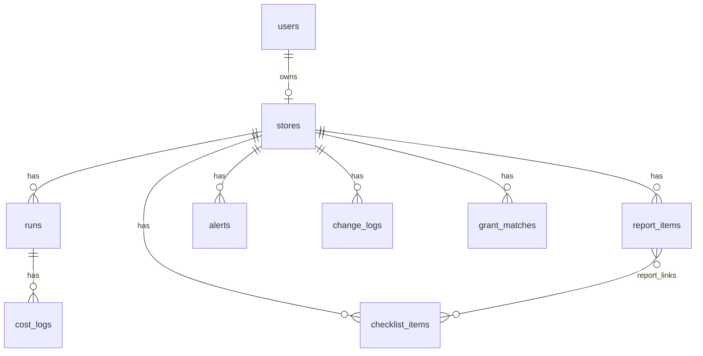

# DB 명세서

# 청년 창업가 종합 솔루션 — DB 명세서 (PostgreSQL)

> 백엔드가 이 문서만 보고 테이블·마이그레이션·저장 로직을 만들 수 있게 쓴 문서.
> 기준 화면: 프로토타입 `foundy`(2026-11-20 확정본). 프로토타입은 브라우저 `localStorage`에 상태를 두므로, 이 문서는 그 **저장 키를 PostgreSQL 테이블로 옮기는 방법**과 API 명세서(`API 명세서.md`)의 응답을 만들기 위한 컬럼을 정한다.
> 구조·인프라는 `아키텍처_인프라.md`, 응답 형식은 `API 명세서.md`, 리포트 JSON 형식은 `report-schema.json`.
> DB: Railway PostgreSQL (백엔드와 같은 Railway 프로젝트, 내부망 `DATABASE_URL`). ORM·마이그레이션 도구는 백엔드 담당이 정한다 (SQLAlchemy + Alembic 권장).

### 변경 이력

| 날짜 | 내용 |
| --- | --- |
| 2026-11-20 | 최초 작성. `foundy` 확정 기능 기준. **상권 분석(상권 테이블·캐시)과 메뉴 광고 문구(`menu_text`)는 마지막에 구현하므로 지금 테이블에 넣지 않고 10장에 추가 방법만 적는다.** 서류함은 규칙 묶음으로 만들어서 테이블이 없다 |

---

## 0. 설계 원칙

1. **상태만 DB에 둔다. 규칙은 DB에 두지 않는다.** 점검 항목·체크리스트 기본 항목·필요 서류·받는 곳 링크·기관 전화번호·통화 질문은 `rules/packs/*.yaml`에 있고 응답을 만들 때 읽는다. 법령 조문 원문도 저장하지 않고 법령 API(또는 `api_cache`)에서 가져온다.
2. **가게 값은 원본을 보존한다.** "술 빼고 시작"처럼 선택지가 가게 정보를 바꾸는 경우 `stores`의 원본 값은 그대로 두고, 점검 카드(`report_items.applied_effects`)에 효과를 붙인다. 실제로 적용되는 값(유효 값)은 `stores` + 선택된 카드들의 효과로 계산한다 (`foundy`의 `eff()`와 같다). 카드를 초기화하면 효과가 사라져 원본으로 돌아간다.
3. **한 계정 = 가게 하나.** 모든 `/stores/{id}/*` 조회는 토큰의 `user_id`와 `stores.user_id`를 비교한다.
4. **정해진 값은 문자열 + `CHECK`로 둔다.** (Postgres enum 대신. 값이 바뀔 때 마이그레이션이 쉽다.)
5. **시각은 `timestamptz`, 날짜는 `date`.** 응답은 +09:00 ISO 8601로 내린다.
6. **키는 두 가지로 둔다.** 내부 `id`는 `uuid`. 화면·API가 쓰는 `item_key`는 가게 안에서만 유일한 짧은 문자열(`r-01`, `c-04`, `x-1`)이고 `foundy`와 같다. API 명세서의 `item_id`는 `item_key`다.

---

## 1. 한눈에 보기



| 테이블 | 역할 | `foundy` 저장 키 | 범위 |
| --- | --- | --- | --- |
| `users` | 소셜 로그인 계정 | `foundy-session`, `profile` | 핵심 |
| `stores` | 가게 정보 (계정당 1개) | `store` | 핵심 |
| `runs` | 분석 실행과 진행 이벤트 (SSE 재생) | (조사 중 진행 화면) | 핵심 |
| `report_items` | 점검 카드 내용과 사용자 진행 상태 | `rs` (카드별 선택·실행·메모) | 핵심 |
| `checklist_items` | 개업 체크리스트 (기본 항목 + 선택으로 생긴 항목 + 지원사업 마감) | `tasksdone`, `xdone`, `autochk` | 핵심 |
| `alerts` | 알림 (결정 필요·다음 할 일·마감·변경·지원사업) | `nextlog`, `alertread` | 핵심 |
| `change_logs` | 마이페이지 변경 기록 | `chglog` | 핵심 |
| `grant_matches` | 지원사업 자격 판정 결과 | (정적 카탈로그 `GRANTS`) | 시간되면 |
| `api_cache` | 외부 API 응답 캐시 | — | 핵심 |
| `cost_logs` | LLM 토큰·비용 (점검 1회 단위) | — | 핵심 |

**테이블이 없는 것**
- **서류함**: 서류 목록·받는 곳 링크·찾는 방법은 규칙 묶음 `documents`·`sites`로 만들고, 요약 숫자는 `checklist_items.done`으로 센다. 서류별 준비 여부를 저장하지 않는다 (`document_states` 없음).
- **AI 상담 대화**: 서버가 저장하지 않는다. 프론트가 `history`로 보낸다. 통화 메모는 카드의 `action_reply`에 남는다.
- **세션**: JWT(무상태). 세션 테이블이 없다.
- **알림 시점 이동(`as_of`)의 예시 알림**: 저장하지 않고 `mocks/`에서 읽어 응답 시 `is_example: true`를 붙인다.
- **마지막에 구현**: 상권 분석(주변 업소·상권 요약·가격 분포), 메뉴·광고 문구 (10장).

---

## 2. 테이블 정의

> DDL은 PostgreSQL 15 기준. `gen_random_uuid()`는 `pgcrypto`(또는 PG13+ 기본 제공)를 쓴다.

### 2-1. `users`

소셜 로그인 계정. 비밀번호는 저장하지 않는다. 예시 계정(`provider = 'demo'`)은 가입 없이 만든다.

```sql
CREATE TABLE users (
  id               uuid PRIMARY KEY DEFAULT gen_random_uuid(),
  provider         text NOT NULL CHECK (provider IN ('kakao','google','naver','demo')),
  provider_user_id text,                        -- 소셜 쪽 사용자 id. demo는 NULL
  name             text NOT NULL,               -- 마이페이지에서 바꿀 수 있는 표시 이름
  joined_at        date NOT NULL DEFAULT CURRENT_DATE,
  created_at       timestamptz NOT NULL DEFAULT now(),
  updated_at       timestamptz NOT NULL DEFAULT now()
);
CREATE UNIQUE INDEX users_provider_uid ON users (provider, provider_user_id)
  WHERE provider_user_id IS NOT NULL;
```

| 컬럼 | 설명 |
| --- | --- |
| `provider` | `kakao`·`google`·`naver`·`demo` |
| `provider_user_id` | OAuth로 얻은 사용자 식별자. 같은 `(provider, provider_user_id)`로 다시 로그인하면 같은 `users` 행을 쓴다 |
| `name` | `PATCH /api/me`로만 바뀐다. 점검 결과에 영향이 없다 |

- `GET /api/me`의 `user`·`store_id`: `store_id`는 `stores`에서 `user_id`로 찾고 없으면 `null` (첫 설정으로 보낸다).
- 예시 계정: `POST /api/demo`가 `users(provider='demo', name='이서연')` 한 행과 가게를 만든다 (9장).

### 2-2. `stores`

계정당 1개. `foundy`의 `Store`(`name`, `type`, `address`, `detail`, `opening`, `birth`, `alcohol`, `terrace`, `employees`, `funds`)에 대응한다. API 명세서의 `answers` 객체는 아래 `sells_alcohol`·`uses_terrace`·`has_employees`·`funds_krw` 컬럼을 묶어 만든 응답 형태다 (컬럼으로 둔 이유: 영향 분석·검증이 쉽다).

```sql
CREATE TABLE stores (
  id                  uuid PRIMARY KEY DEFAULT gen_random_uuid(),
  user_id             uuid NOT NULL UNIQUE REFERENCES users(id) ON DELETE CASCADE,  -- 계정당 1개
  name                text NOT NULL,                  -- 상호 (원본. 선택으로 바뀐 이름은 report_items.applied_effects)
  business_type_input text NOT NULL DEFAULT '카페'
                       CHECK (business_type_input IN ('카페','음식점')),
  business_type       text,                           -- 규칙 묶음이 결정한 신고 업종 (휴게음식점|일반음식점)
  address             text NOT NULL,                  -- 도로명주소 (입지를 정한 주소)
  address_detail      text NOT NULL DEFAULT '',       -- 층·호
  address_codes       jsonb,                          -- {sigungu_cd, bjdong_cd, bun, ji, coord:{lat,lng}}
  region              text,                           -- 주소에서 얻은 시군구·동 (예: 서울 성동구 성수동)
  opening_date        date NOT NULL,                  -- 개업 예정일 (역산 기준)
  owner_birth_year    int CHECK (owner_birth_year BETWEEN 1900 AND 2100),  -- 지원사업 자격용, 선택
  sells_alcohol       boolean NOT NULL DEFAULT false,
  uses_terrace        boolean NOT NULL DEFAULT false,
  has_employees       boolean NOT NULL DEFAULT false,
  funds_krw           bigint CHECK (funds_krw >= 0),  -- 준비 자금, 선택
  onboarded_at        timestamptz,                    -- 첫 설정(분석)을 마친 시각. NULL이면 첫 설정 중
  is_demo             boolean NOT NULL DEFAULT false,
  created_at          timestamptz NOT NULL DEFAULT now(),
  updated_at          timestamptz NOT NULL DEFAULT now()
);
```

| 컬럼 | 설명 | `foundy` 필드 |
| --- | --- | --- |
| `name` | 상호. **원본 보존** | `name` |
| `business_type_input` | 사용자가 고른 업종. MVP는 카페·음식점만 | `type` |
| `business_type` | 규칙 `derive`로 계산: 술 판매 → 일반음식점, 아니면 휴게음식점. **유효 값**(선택 효과 적용)으로 계산해 저장하지 않고 응답 때 계산해도 된다 | (파생) |
| `address`, `address_detail` | 도로명주소, 층·호 | `address`, `detail` |
| `address_codes` | 주소 → 법정동코드·번·지·좌표 (건축물대장 조회 입력) | (서버) |
| `opening_date` | 개업일. 바뀌면 `checklist_items` 날짜만 다시 계산 | `opening` |
| `owner_birth_year` | 출생 연도 | `birth` |
| `sells_alcohol`·`uses_terrace`·`has_employees` | 되묻기 답변 (술 판매, 테라스·옥외 공간, 직원 고용) | `alcohol`, `terrace`, `employees` |
| `funds_krw` | 준비 자금 | `funds` |
| `onboarded_at` | 첫 설정 완료 시각. `foundy`의 `onboarded` | `onboarded` |
| `region` | 응답의 `region` (주소에서 파생) | `region` |

- `foundy`의 `location`(`decided`/`undecided`)과 `mainManual`, `candx`(후보 자리)는 **저장하지 않는다.** 서비스는 입지를 정한 사용자만 대상이고 후보 자리 기능이 없다.
- **필수 입력**: `name`, `address`, `opening_date`. 주소가 비면 저장을 막는다 (마이페이지와 같은 규칙).
- **유효 값(effective)**: 점검·체크리스트·알림을 만들 때는 `stores` 값에 선택된 카드의 `applied_effects`를 덧씌운 값을 쓴다 (5-2).
- 새 가게 등록(`POST /stores`) 때 `409 STORE_EXISTS` 검사는 `user_id UNIQUE`로 보장한다.
- **마이페이지의 "가게 정보 다시 설정"**: `foundy`의 `wipeStore`와 같다. 계정(`users`)은 남기고 그 계정의 가게를 삭제한다 (`DELETE FROM stores WHERE user_id = ?`, 하위 테이블은 `ON DELETE CASCADE`). 이후 첫 설정으로 돌아간다.

### 2-3. `runs`

분석 실행 1회. 첫 설정, 마이페이지 재반영, 선택지 적용 후 재분석, (다시 조회)가 모두 `runs` 한 행이다. SSE 이벤트를 재생·폴링하려고 `events`를 저장한다.

```sql
CREATE TABLE runs (
  id          uuid PRIMARY KEY DEFAULT gen_random_uuid(),
  store_id    uuid NOT NULL REFERENCES stores(id) ON DELETE CASCADE,
  trigger     text NOT NULL CHECK (trigger IN ('user','refresh','chat','demo')),
  scope       jsonb NOT NULL DEFAULT '[]',   -- 다시 돌린 단계: ["building","law","trademark","checklist","grants"]
  status      text NOT NULL DEFAULT 'queued' CHECK (status IN ('queued','running','done','failed')),
  events      jsonb NOT NULL DEFAULT '[]',   -- [{step,status,message,source,at}]
  error       text,
  started_at  timestamptz,
  finished_at timestamptz,
  created_at  timestamptz NOT NULL DEFAULT now()
);
CREATE INDEX runs_store ON runs (store_id, created_at DESC);
-- 같은 가게에서 동시에 하나만 실행 (409 RUN_IN_PROGRESS)
CREATE UNIQUE INDEX runs_one_active ON runs (store_id) WHERE status IN ('queued','running');
```

- `scope`: 마이페이지 수정으로 시작한 재분석은 `impacts`에 해당하는 단계만 담는다 (`dates`는 DB 호출만 하고 외부 조회·LLM이 없다).
- `events[].status`: `running | done | fallback | skipped | failed`. `fallback`은 캐시·모의 응답으로 대체했다는 뜻이고 화면에 표시한다.
- 오래 걸리거나 서버가 재시작되면 `running`인 행이 남는다. 시작 시 `status IN ('queued','running')`이고 `started_at`이 10분 넘은 행은 `failed`로 정리한다.

### 2-4. `report_items`

점검 리포트의 카드 한 장. **카드 내용**(분석이 만든 것)과 **사용자 진행 상태**(결정·실행·메모)를 한 행에 둔다. `foundy`는 내용을 `buildCards`로 매번 계산하고 상태만 `rs`에 저장하지만, 백엔드는 분석 결과를 저장해야 하므로 합친다.

```sql
CREATE TABLE report_items (
  id              uuid PRIMARY KEY DEFAULT gen_random_uuid(),
  store_id        uuid NOT NULL REFERENCES stores(id) ON DELETE CASCADE,
  run_id          uuid REFERENCES runs(id) ON DELETE SET NULL,   -- 이 내용을 만든 실행
  item_key        text NOT NULL,           -- 'r-01' … (API의 item_id)
  check_id        text NOT NULL,           -- 규칙 묶음의 점검 항목 id (building_use …)
  stage           text NOT NULL CHECK (stage IN ('계약 전','개업 전','운영 중')),
  -- 내용 (분석이 만든다)
  verdict         text NOT NULL CHECK (verdict IN ('high','low','unknown','ok')),
  decided_by      text NOT NULL CHECK (decided_by IN ('rule','ai')),
  title           text NOT NULL,           -- 결론 한 줄 (쉬운 말)
  reason          text,
  consequence     text,                    -- 안 하면 생기는 일
  options         jsonb NOT NULL DEFAULT '[]',   -- 선택지 (아래)
  recommendation  jsonb,                   -- {option_id, reason} 또는 NULL
  user_action     jsonb,                   -- {type, text, est_minutes} 또는 NULL (기본 할 일)
  contact_key     text,                    -- 규칙 묶음 contacts의 키 (build|hyg|…). 번호는 응답 때 채운다
  evidence        jsonb NOT NULL DEFAULT '[]',   -- Evidence 목록 (비면 verdict는 unknown)
  -- 사용자 진행 상태
  chosen_option   text,                    -- 고른 option_id. 아직이면 NULL
  chosen_at       timestamptz,
  action_status   text NOT NULL DEFAULT 'pending' CHECK (action_status IN ('pending','sent','done')),
  action_reply    text,                    -- 결과·통화 메모
  action_updated_at timestamptz,
  verdict_before  text CHECK (verdict_before IN ('high','low','unknown','ok')),
  resolved_title  text,                    -- 선택 적용 후 바뀐 결론
  applied_effects jsonb NOT NULL DEFAULT '{}',   -- 유효 값에 덧씌울 효과 (아래)
  applied_changes jsonb NOT NULL DEFAULT '[]',   -- 화면에 보일 바뀐 내용 문장 목록
  created_at      timestamptz NOT NULL DEFAULT now(),
  updated_at      timestamptz NOT NULL DEFAULT now(),
  UNIQUE (store_id, item_key),
  UNIQUE (store_id, check_id)
);
CREATE INDEX report_items_store_stage ON report_items (store_id, stage);
```

`foundy`의 점검 항목(규칙 묶음 `checks`의 순서가 `item_key`를 정한다):

| `item_key` | `check_id` | `stage` | 기본 판정 | 결정 방식 | 선택지 | 연락처 |
| --- | --- | --- | --- | --- | --- | --- |
| `r-01` | `building_use` | 계약 전 | 술 판매 → `high`, 아니면 `ok` | `rule` | 술 빼고 카페로 시작(`o-1`) / 용도변경 신청(`o-2`) / 다른 자리를 알아보기(`o-3`) | `build` |
| `r-02` | `trademark_similar` | 계약 전 | `low` | `ai` | 이름 바꾸기(`o-1`) / 그대로 진행(`o-2`) | — |
| `r-03` | `building_violation` | 계약 전 | `unknown` (대장 응답에 위반건축물 표기 없음) | `rule` | 없음 | `build` |
| `r-04` | `permit_docs` | 개업 전 | `low` | `ai` | 없음 | `hyg` |
| `r-05` | `labeling` | 운영 중 | `ok` | `rule` | 없음 | — |

- 술을 안 파는 가게의 `r-01`은 `ok`이고 `options`가 빈 배열이며 `user_action`이 `NULL`이다 (결과 카드가 아니다).
- `verdict`: `high`는 규칙이 데이터로 확인한 경우만, AI 판정(`decided_by='ai'`)의 상한은 `low`. 근거(`evidence`)가 없으면 `unknown`.

**`options` jsonb** (API 명세서 Option과 같다)

```json
[
  { "option_id": "o-1", "label": "술 빼고 카페로 시작", "summary": "휴게음식점으로 신고합니다. 바로 가능해요.",
    "time": { "text": "즉시", "basis": "rule" }, "cost": { "text": "추가 비용 없음", "delta_krw": 0, "basis": "rule" },
    "apply": { "type": "update_store", "effects": { "sells_alcohol": false }, "verdict": "ok",
               "resolved_title": "술 없이 카페로 시작하면 이 자리에서 열 수 있어요", "adds_checklist": [] },
    "applied_changes": ["업종 변경: 일반음식점 → 휴게음식점 (주류 판매 안 함, 규칙)", "체크리스트 변경: “영업신고” 항목이 휴게음식점 기준으로 바뀜", "재분석: 건물 용도 점검 위반 소지 높음 → 문제 없음"],
    "user_action": { "type": "decide", "text": "메뉴에서 주류를 빼기로 확정하기", "est_minutes": 3 },
    "remedy": "change_business_type" }
]
```

- `apply.type`: `update_store`(가게 값 효과) | `none`(기록만). `apply.verdict`는 선택 후의 판정, `apply.adds_checklist`는 체크리스트에 새로 생길 항목 `item_key`.
- 선택지별 `user_action`이 있으면 선택 후에는 그것을, 없으면 카드의 `user_action`을 쓴다 (`foundy`의 `curAction`).
- `time`·`cost`: `basis`가 `NULL`이면 `text`는 "확인 필요", `delta_krw`는 `NULL`. 근거 없는 숫자를 쓰지 않는다.

**`applied_effects` jsonb** — 선택한 카드의 효과. 유효 값 계산에 쓴다.

```json
{ "sells_alcohol": false }          // o-1 (r-01)
{ "name": "모노로스터스" }            // o-1 (r-02, 이름 바꾸기. 후보 이름은 예시)
{}                                   // 효과 없음 (용도변경 신청, 다른 자리, 그대로 진행)
```

- 허용 키: `sells_alcohol`, `name` (규칙 묶음이 허용한 키만 서버가 저장한다).
- `adds_checklist`로 생기는 항목은 `checklist_items`에 `source='report'`로 따로 저장한다 (2-5).

**상태 전이** (`foundy` 카드 진행: 결정 → 실행 → 완료)

| 사건 | 바뀌는 컬럼 |
| --- | --- |
| 선택지 고름 `POST /choose` | `chosen_option`, `chosen_at`, `applied_effects`, `applied_changes`, `resolved_title`, `verdict_before`(판정이 바뀔 때), `action_status='pending'`. 선택지가 `adds_checklist`를 가지면 `checklist_items` 추가 |
| 선택 변경·되돌리기 | 위 컬럼을 비우고 `action_status='pending'`. 그 선택으로 생긴 `checklist_items`(`source='report'`)와 이 카드가 만든 자동 체크를 되돌린다 |
| 실행 `POST /action {status:'sent'}` | `action_status='sent'`, `action_reply`, `action_updated_at`. `alerts`(next) 생성·갱신 |
| 완료 `POST /action {status:'done'}` | `action_status='done'`. 자동 체크(5-4), `alerts`(next) 갱신 |
| 완료 취소 `{status:'pending'}` | `action_status='pending'`. 자동 체크만 풀고 `alerts`(next) 삭제 |
| 통화 메모 저장 (상담의 "통화 결과 기록") | 선택지가 필요한 카드는 `chosen_option` 없이 `action_reply`만 저장하고, 선택지가 필요 없거나 이미 골랐으면 `action_status='sent'` + `action_reply` |
| 마이페이지 수정으로 영향받음 | 상태 컬럼 전부 초기화 (5-3) |

- `chosen_option IS NULL`이고 `options`가 비어 있지 않으면 **결정 대기 카드**다 (`pending_decisions`, 알림 `decision`).
- **현재 판정(`ev`)**: 선택했고 `options[chosen].apply.verdict`가 있으면 그 값, 아니면 `verdict`.

### 2-5. `checklist_items`

개업 체크리스트. 기본 항목(규칙 묶음), 선택지로 생긴 항목(`x-*`), 지원사업 마감(`g-*`)이 한 테이블에 있다.

```sql
CREATE TABLE checklist_items (
  id              uuid PRIMARY KEY DEFAULT gen_random_uuid(),
  store_id        uuid NOT NULL REFERENCES stores(id) ON DELETE CASCADE,
  item_key        text NOT NULL,        -- 'c-01'…'c-09' (기본), 'x-0'… (선택지로 생김), 'g-…' (지원사업)
  source          text NOT NULL CHECK (source IN ('rule','report','grant')),
  rule_key        text,                 -- 규칙 묶음의 항목 키 (서류 목록을 찾는 키)
  task            text NOT NULL,
  category        text NOT NULL CHECK (category IN ('영업 인허가','세무','고용','건물·시설','간판·광고','표시 의무','정책')),
  group_label     text NOT NULL CHECK (group_label IN ('계약 전','개업 4주 전','개업 직전','개업 후')),
  offset_days     int NOT NULL,         -- 개업일 기준 일수 (음수 = 개업 전). 규칙 묶음 값
  due_date        date NOT NULL,        -- opening_date + offset_days (계산 도구)
  agency          text,                 -- 담당 기관 이름
  contact_key     text,                 -- contacts 키 (번호는 응답 때 채운다)
  origin_item_key text,                 -- source='report': 이 항목을 만든 점검 카드 item_key
  origin_option   text,                 -- source='report': 이 항목을 만든 option_id
  evidence        jsonb NOT NULL DEFAULT '[]',
  done            boolean NOT NULL DEFAULT false,
  done_at         timestamptz,
  auto_checked    boolean NOT NULL DEFAULT false,  -- 점검 카드 완료로 자동 체크됐는지
  created_at      timestamptz NOT NULL DEFAULT now(),
  updated_at      timestamptz NOT NULL DEFAULT now(),
  UNIQUE (store_id, item_key)
);
CREATE INDEX checklist_store_due ON checklist_items (store_id, due_date);
```

`foundy`의 기본 항목 (규칙 묶음 `checklist`가 정하고 첫 분석 때 `source='rule'`로 만든다)

| `item_key` | 항목 | 카테고리 | 시기 | `offset_days` | 담당 기관 | 연결된 점검 카드 (`report_links`) |
| --- | --- | --- | --- | --- | --- | --- |
| `c-01` | 건축물대장 확인 및 임대차 계약 검토 | 건물·시설 | 계약 전 | -56 | 관할 구청 건축과 | `r-01`, `r-03` |
| `c-02` | 상호·상표 유사 여부 추가 확인 | 간판·광고 | 계약 전 | -49 | KIPRIS | `r-02` |
| `c-03` | 사업자등록 신청 | 세무 | 개업 4주 전 | -28 | 홈택스 또는 세무서 | — |
| `c-04` | 영업 신고에 필요한 서류 준비 (제목 앞에 일반음식점/휴게음식점이 붙는다) | 영업 인허가 | 개업 4주 전 | -28 | 관할 구청 위생과 | `r-04` |
| `c-05` | 식품위생교육 이수 | 영업 인허가 | 개업 4주 전 | -22 | 관련 교육기관 | — |
| `c-06` | 건강진단결과서 준비 | 영업 인허가 | 개업 직전 | -10 | 보건소 등 | — |
| `c-07` | 간판 설치 관련 기준 확인 | 간판·광고 | 개업 직전 | -6 | 관할 구청 | — |
| `c-08` | 근로계약서 및 고용 관련 사항 확인 | 고용 | 개업 직전 | -3 | 고용노동부 안내 | — |
| `c-09` | 운영 중 표시 의무 사항 점검 | 표시 의무 | 개업 후 | +7 | 관할 기관 | — |

선택지로 생기는 항목 (`source='report'`)

| `item_key` | 항목 | 생기는 선택지 | 카테고리 | 시기 | `offset_days` | 담당 | 연결된 카드 |
| --- | --- | --- | --- | --- | --- | --- | --- |
| `x-0` | 용도가 맞는 다른 후보 자리 알아보기 | `r-01`의 `o-3` | 건물·시설 | 계약 전 | -70 | 본인 확인 | `r-01` |
| `x-1` | 구청 건축과에 용도변경 가능 여부 문의 | `r-01`의 `o-2` | 건물·시설 | 계약 전 | -60 | 관할 구청 건축과 | `r-01` |
| `x-2` | 간판 제작 전 상표 최종 확인 (KIPRIS) | `r-02`의 `o-2` | 간판·광고 | 계약 전 | -30 | KIPRIS | `r-02` |

- **`group_label`은 항목마다 규칙 묶음에 적힌 고정 값이다.** `dday`로 계산해 나누지 않는다 (`foundy`가 그렇다). `dday`는 응답 때 `due_date`와 오늘로 계산한다 (`D-56`, 지난 날은 `D+3`).
- **`due_date`는 계산 도구가 만든다**: `opening_date + offset_days`. 개업일만 바뀌면 이 컬럼만 다시 계산한다 (외부 조회·LLM 없음).
- **조건부 항목**: `c-08`(카테고리 `고용`)은 `stores.has_employees = false`이면 응답에서 숨긴다 (행은 두고 `hidden_categories`로 알린다). `c-04`의 제목은 유효 값의 `sells_alcohol`로 만든다.
- **`report_links`**: 체크리스트 항목과 점검 카드의 연결은 규칙 묶음(`report_links`)에 있고, 테이블에 저장하지 않는다. 응답의 `report_item_ids`도 규칙에서 만든다. (규칙을 바꾸면 기존 가게에도 바로 적용된다.)
- **서류**: `checklist_items`에 서류를 저장하지 않는다. `rule_key`로 규칙 묶음 `documents`를 찾아 응답에 붙인다 (7장). 선택지 항목(`x-*`)의 서류도 같은 방식이고 그 카드를 되돌려 행이 삭제되면 같이 사라진다.
- **지원사업 마감 항목**(`source='grant'`): 마감일이 지나지 않은 `eligible`·`partial` 공고만 `g-<grant_id>`로 추가한다 (`unknown`은 넣지 않는다). `offset_days`는 `due_date - opening_date`로 채우고, `group_label`만 `dday`로 정한다 (≤ -29 계약 전, -28~-15 개업 4주 전, -14~-1 개업 직전, 0 이상 개업 후).
- **완료 체크**
  - 사용자가 직접 체크: `done = true`, `done_at = now()`, `auto_checked = false`.
  - 점검 카드 완료로 자동 체크: `done = true`, `auto_checked = true` (5-4).
  - 자동 체크된 항목만 카드를 되돌릴 때 풀린다. 사용자가 직접 바꾼 체크는 유지한다 (`auto_checked = false`로 덮는다).
- 재분석으로 체크리스트를 다시 만들 때 `done`·`auto_checked`는 `item_key`가 같은 항목끼리 이어받는다.

### 2-6. `alerts`

알림 센터. `foundy`의 유형 탭과 같다: `decision`(결정 필요) · `next`(다음 할 일) · `deadline`(마감 임박) · `change`(변경 감지) · `grant`(새 지원사업).

```sql
CREATE TABLE alerts (
  id          uuid PRIMARY KEY DEFAULT gen_random_uuid(),
  store_id    uuid NOT NULL REFERENCES stores(id) ON DELETE CASCADE,
  dedupe_key  text NOT NULL,          -- 같은 사건을 중복 생성하지 않는 키 (아래 표)
  type        text NOT NULL CHECK (type IN ('decision','next','deadline','change','grant')),
  title       text NOT NULL,
  body        text,
  cta         jsonb,                  -- {label, page, item_id}
  diff        jsonb,                  -- 변경 전후 (선택)
  is_example  boolean NOT NULL DEFAULT false,
  read        boolean NOT NULL DEFAULT false,
  created_at  timestamptz NOT NULL DEFAULT now(),
  UNIQUE (store_id, dedupe_key)
);
CREATE INDEX alerts_store_type ON alerts (store_id, type, created_at DESC);
```

| 유형 | 만드는 때 | `dedupe_key` | 지우는 때 |
| --- | --- | --- | --- |
| `decision` | 선택지가 있는데 아직 고르지 않은 카드가 있을 때 | `dec-<item_key>` | 그 카드를 고르면 |
| `next` | 카드를 `sent`·`done`으로 바꿀 때 (카드당 1개, 갱신) | `next-<item_key>` | 카드를 `pending`으로 되돌리거나 초기화할 때. 카드당 최근 6개까지만 둔다 |
| `change` | 마이페이지 수정 반영 (`change_logs` 1건당 1개) | `chg-<change_log_id>` | 오래된 것은 정리 (최근 10건) |
| `deadline` | 체크리스트 기한·지원사업 마감 | `dl-<item_key>` | 완료하면 |
| `grant` | 새 지원사업 공고 | `gr-<grant_id>` | — |

- `next` 알림 문구: 완료면 `“{카드 짧은 이름}” 완료 · 다음 할 일 N개`, 실행(sent)이면 `“…” 문의함 · 먼저 할 일 N개`. 본문은 다음 할 일 제목 상위 3개를 `→`로 이은 것이고 없으면 "모든 점검을 마쳤어요". `cta`는 `{label:'카드 열기', page:'report', item_id}`.
- `change` 알림: 제목 "가게 정보를 바꿔 다시 반영했어요", 본문은 바뀐 줄 상위 3개를 `·`로 이은 것, `cta`는 마이페이지.
- 읽음: `PATCH /alerts/{id}` → `read = true`. `foundy`의 `alertread`다.
- **시점 이동(`as_of`) 알림은 저장하지 않는다.** `as_of`가 오면 서버가 `checklist_items`와 `mocks/`로 응답을 만들고 예시는 `is_example: true`. (개업 D-7: 기한 지난 항목·곧 해야 하는 항목, 개업 6개월 후: 부가세·위생교육 갱신 확인 등.)

### 2-7. `change_logs`

마이페이지에서 가게 정보를 바꿀 때마다 1건. 최근 10건을 응답한다.

```sql
CREATE TABLE change_logs (
  id          uuid PRIMARY KEY DEFAULT gen_random_uuid(),
  store_id    uuid NOT NULL REFERENCES stores(id) ON DELETE CASCADE,
  changed     jsonb NOT NULL,                 -- [{field, from, to}]
  impacts     jsonb NOT NULL DEFAULT '[]',    -- ["building","law","checklist"]
  reset_items jsonb NOT NULL DEFAULT '[]',    -- [{item_key, title, chosen_label}] 초기화된 카드
  lines       jsonb NOT NULL DEFAULT '[]',    -- 화면 문장 ["주소: … → …", "건물 용도·주류 카드 선택 초기화 (다시 결정 대기)"]
  created_at  timestamptz NOT NULL DEFAULT now()
);
CREATE INDEX change_logs_store ON change_logs (store_id, created_at DESC);
```

### 2-8. `grant_matches` [시간되면]

지원사업 자격 판정 결과 (가게별). 공고 N건에 LLM 호출이 N번 나가므로 판정 결과를 저장하고 `GET /grants`는 저장본을 읽는다. 새로 판정하는 때는 분석 실행, 다시 조회, `owner_birth_year`·`address`·`business_type_input` 변경 후다.

```sql
CREATE TABLE grant_matches (
  id            uuid PRIMARY KEY DEFAULT gen_random_uuid(),
  store_id      uuid NOT NULL REFERENCES stores(id) ON DELETE CASCADE,
  grant_id      text NOT NULL,            -- 공고 id (예: kstartup-000000)
  title         text NOT NULL,
  source        text NOT NULL,            -- K-Startup | 기업마당 …
  url           text,
  category      text,                     -- 사업화 | 융자 | 공간 | 교육 | 멘토링
  region        text,
  amount_text   text,
  deadline      date,                     -- NULL = 상시·미정
  result        text NOT NULL CHECK (result IN ('eligible','partial','unknown')),
  checks        jsonb NOT NULL DEFAULT '[]',   -- [{condition, result: pass|unknown, evidence:{type:'notice', text, url}, note}]
  summary       jsonb,                    -- {who, how_much, until, what_to_submit[], by:'ai'}
  poster        jsonb,                    -- {url, source:'api'|'generated', credit}
  excluded      boolean NOT NULL DEFAULT false,   -- 명확히 fail → 목록 제외 (건수만 알림)
  added_to_checklist boolean NOT NULL DEFAULT false,
  judged_at     timestamptz NOT NULL DEFAULT now(),
  UNIQUE (store_id, grant_id)
);
CREATE INDEX grant_matches_store_deadline ON grant_matches (store_id, deadline);
```

- `excluded` 행은 `excluded_count`를 세는 용도이고 목록에는 내리지 않는다. 마감이 지난 공고는 `closed_count`로만 알린다.
- 근거가 없는 조건은 `unknown`. 인용 문장이 공고 원문에 실제로 없거나 숫자 조건의 숫자가 인용에 없으면 그 조건은 `unknown`이고 `evidence`는 `NULL` (서버 검증).
- 신청 가능성 표시값(`eligible`→"신청 가능성 높음", `partial`→"일부 확인 필요", `unknown`→"판단 불가")은 화면 문구다. 저장하지 않는다.
- 포스터: 공고 응답에 이미지가 있으면 `{url, source:'api', credit}`, 없으면 `{url:null, source:'generated'}`로 두고 화면이 제목·기관·마감으로 포스터형 카드를 그린다 (이미지는 AI가 만들지 않는다).

### 2-9. `api_cache`

같은 주소·같은 조문·같은 상표를 반복 조회하지 않으려는 외부 API 응답 캐시.

```sql
CREATE TABLE api_cache (
  key         text PRIMARY KEY,         -- '<source>:<params 해시>'
  source      text NOT NULL,            -- address | building | law | trademark | grants
  payload     jsonb NOT NULL,
  fetched_at  timestamptz NOT NULL DEFAULT now(),
  expires_at  timestamptz NOT NULL
);
CREATE INDEX api_cache_expires ON api_cache (expires_at);
```

| `source` | 캐시 만료 |
| --- | --- |
| `address` | 30일 |
| `building` | 7일 |
| `law` | 1일 |
| `trademark` | 7일 |
| `grants` | 1일 |

- 조회가 실패하면 만료된 캐시도 쓰고(`from_cache: true`), 그것도 없으면 `mocks/`의 모의 응답을 쓴다 (`from_mock: true`). 근거(Evidence)에 이 표시를 남긴다.
- 법령 조문은 저장해 두지 않는 것이 원칙이므로 `law` 캐시는 짧게(1일) 둔다. 상권(주변 업소) 캐시는 마지막에 구현할 때 `source = 'places'`(7일)로 추가한다 (10장).

### 2-10. `cost_logs`

점검 1회(`runs` 1행)의 단계별 토큰·비용. LLM 비용 실측과 예산 관리용이다.

```sql
CREATE TABLE cost_logs (
  id             uuid PRIMARY KEY DEFAULT gen_random_uuid(),
  run_id         uuid NOT NULL REFERENCES runs(id) ON DELETE CASCADE,
  step           text NOT NULL,         -- select_questions | interpret | advise | grants | chat …
  model          text NOT NULL,
  input_tokens   int NOT NULL DEFAULT 0,
  output_tokens  int NOT NULL DEFAULT 0,
  cost_krw       numeric(12,2) NOT NULL DEFAULT 0
);
CREATE INDEX cost_logs_run ON cost_logs (run_id);
```

- 챗봇 호출은 `runs(trigger='chat')`를 만들어 연결하거나(아키텍처 문서의 방식) `run_id`를 NULL 허용으로 바꿔 `store_id`를 직접 두는 방식 중 백엔드가 고른다. 후자를 쓰면 `ALTER TABLE cost_logs ALTER COLUMN run_id DROP NOT NULL; ADD COLUMN store_id uuid REFERENCES stores(id)`를 추가한다.

---

## 3. 핵심 화면별로 읽는 쿼리

| 화면(API) | 읽는 곳 | 계산 |
| --- | --- | --- |
| 내 가게 홈 (`GET /dashboard`) | `stores`, `report_items`, `checklist_items`, `alerts` | 결정할 것 = `chosen_option IS NULL AND options 있음`. 직접 할 일 = 선택지를 골랐거나 선택지가 없는 카드 중 `action_status <> 'done'` 이고 `user_action` 있음. 다음 할 일 = 5-5. 체크리스트 진행 = `done` / 전체(숨김 제외). 서류 요약 = 서류 수(규칙) / 완료한 항목의 서류 수. 읽지 않은 알림 수 = `read = false` |
| 점검 리포트 (`GET /report`) | `report_items` (+ 규칙 `contacts`) | 위험한 것부터 정렬(현재 판정 `high`→`low`→`unknown`→`ok`). 후속 행동을 마치기 전에는 원래 판정 자리에 둔다 |
| 체크리스트 (`GET /checklist`) | `checklist_items` (+ 규칙 `documents`, `report_links`, `contacts`) | `dday` = `due_date` − 오늘. 시기별은 `group_label`, 카테고리별은 `category`. 달력·`.ics`는 프론트가 같은 응답으로 만든다 |
| 서류함 (`GET /documents`) | `checklist_items` (+ 규칙 `documents`, `sites`, `contacts`) | 서류가 있는 항목만 `due_date`순. 요약: 전체 서류 수, 완료한 항목의 서류 수, 남은 수 |
| 알림 센터 (`GET /alerts`) | `alerts` (+ `as_of`이면 `mocks/`) | 유형 탭은 `type`. 최신순 |
| 마이페이지 (`GET /stores/{id}`, `/changes`) | `stores`, `change_logs` | 유효 값(선택 효과 적용)도 함께 보여준다 |
| 지원사업 (`GET /grants`) | `grant_matches` | `filter=eligible`·`closing_soon` 백엔드 필터, 분야·지역·정렬은 프론트 |

---

## 4. 같은 일을 하는 서버 처리 (트랜잭션 단위)

아래 처리는 각각 **하나의 DB 트랜잭션**으로 묶는다 (중간에 실패하면 모두 되돌린다).

### 4-1. 첫 설정 (`POST /stores` → `/answers` → `/analyze`)

1. `users` 확인 → `stores` 삽입 (`address_codes`는 주소 도구 결과). 이미 있으면 `409 STORE_EXISTS`.
2. `/answers`로 `sells_alcohol`·`uses_terrace`·`has_employees`·`funds_krw`를 `stores`에 저장하고 `business_type`을 규칙으로 정한다.
3. `/analyze`: `runs` 삽입 → 조회·판정·선택지 생성 → `report_items`(규칙 `checks` 순서대로 `r-01`…), `checklist_items`(규칙 기본 항목 + 날짜 계산), `grant_matches`(시간되면), `cost_logs`, `alerts`(결정 대기 카드마다 `decision`) 저장 → `stores.onboarded_at = now()`, `runs.status = 'done'`.
4. 도구가 실패해도 그 항목만 `verdict='unknown'`으로 두고 끝까지 진행한다 (예외로 전체를 실패시키지 않는다).

### 4-2. 선택지 적용 (`POST /report/items/{item_key}/choose`)

1. 카드의 `options`에서 `option_id`를 찾는다. 없으면 `400 INVALID_INPUT`.
2. 이미 다른 선택이 있으면 먼저 되돌린다 (4-4의 "선택 취소").
3. `chosen_option`, `chosen_at`, `applied_effects = apply.effects`, `applied_changes`, `resolved_title`, `verdict_before`(현재 판정과 `apply.verdict`가 다를 때)를 저장하고 `action_status='pending'`, `action_reply`는 유지.
4. `apply.adds_checklist`의 각 `item_key`를 `checklist_items`에 삽입 (`source='report'`, `origin_item_key`, `origin_option`, `due_date = opening_date + offset_days`). 이미 있으면 건너뛴다.
5. `alerts`의 `dec-<item_key>` 삭제.
6. 유효 값이 바뀌었으면 체크리스트 제목(`c-04`)·영향받는 점검이 다시 계산된다 (필요하면 `runs` 생성, `needs_reanalyze`).
7. 응답: `applied_changes`, `added_checklist`, `needs_reanalyze`.

### 4-3. 실행·완료 (`POST /report/items/{item_key}/action`)

1. `action_status`·`action_reply`·`action_updated_at` 갱신.
2. **자동 체크 동기화** (5-4).
3. `alerts`: `sent`·`done`이면 `next-<item_key>` upsert, `pending`이면 삭제. `done`이면 관련 `decision` 알림도 닫는다.
4. 응답: `next_steps[]` (5-5), `auto_checked[]`.

### 4-4. 선택 변경·되돌리기, 카드 초기화

"카드 상태 비우기"는 한 함수로 만든다 (선택 취소와 마이페이지 초기화가 같이 쓴다).

```
reset_card(item):
  UPDATE report_items SET chosen_option=NULL, chosen_at=NULL, action_status='pending',
         action_reply=NULL, action_updated_at=NULL, verdict_before=NULL, resolved_title=NULL,
         applied_effects='{}', applied_changes='[]'
  DELETE FROM checklist_items WHERE store_id=? AND source='report' AND origin_item_key=item.item_key
  DELETE FROM alerts WHERE store_id=? AND dedupe_key IN ('next-'||item_key)
  -- 선택지가 있는 카드는 다시 결정 대기가 되므로 decision 알림을 다시 만든다
  동기화: 5-4
```

- 선택을 바꾸면(`/choose`를 다시 호출) 이전 선택의 효과·항목을 위 방식으로 지운 뒤 새 선택을 적용한다.

### 4-4a. 체크리스트 직접 체크 (`PATCH /checklist/{item_key}`)

`done`·`done_at`을 바꾸고 `auto_checked = false`로 둔다 (사용자가 직접 한 체크는 자동 해제 대상이 아니다). 이 변경이 점검 카드를 완료로 바꾸지는 않는다 (한 방향 연동).

### 4-5. 마이페이지 수정 (`PATCH /stores/{id}`)

1. 바꾼 필드 목록(`changed`)을 만든다. 바뀐 게 없으면 `400`. `address`가 비면 `400`.
2. **영향 분석 (코드)**: 아래 표로 `impacts`를 만든다.

| 바꾼 필드 | `impacts` | 다시 하는 일 | 초기화되는 카드 |
| --- | --- | --- | --- |
| `opening_date` | `dates` | 체크리스트 `due_date`만 재계산 | 없음 |
| `name` | `trademark` | 상표 검색 | `r-02` |
| `address`, `business_type_input`, `sells_alcohol` | `building`, `law`, `checklist` | 건축물대장·조문 조회, 체크리스트 재구성 | `r-01`, `r-03`, `r-04` |
| `address_detail` | `building` | 건축물대장 조회 | `r-01`, `r-03` |
| `uses_terrace` | `law`, `checklist` | 옥외영업 점검 | `r-01`, `r-04` |
| `has_employees` | `checklist` | 고용 카테고리 표시 | 없음 |
| `owner_birth_year` | `grants` | 지원사업 자격 판정 | 없음 |
| `funds_krw` | `costs` | 비용 계산 | 없음 |

   (`foundy`의 `IMPCARDS`: `building → r-01, r-03`, `law → r-01, r-04`, `trademark → r-02`. 규칙 묶음의 `impacts` 표로 둔다.)

3. 초기화할 카드마다 `reset_card` (4-4) → `change_logs` 삽입(+ `alerts` `change`) → `stores` 갱신 → 체크리스트 `due_date` 재계산 → 필요한 단계만 `runs(trigger='user', scope=…)`로 재분석.
4. **저장 전 미리보기**: `?dry_run=true`이면 1~2단계만 하고 `impacts`·`reset_items`를 돌려준다 (DB 변경 없음). 프론트는 같은 규칙으로 직접 계산해도 된다.
5. 개업일만 바뀌면 `recomputed: ["checklist"]`만 돌려주고 외부 조회·LLM을 부르지 않는다.

### 4-6. 가게 정보 다시 설정 / 계정 전환

- 다시 설정: `DELETE FROM stores WHERE user_id = ?` (CASCADE로 하위 데이터 삭제) 후 첫 설정으로 이동.
- 계정 전환: 토큰의 `user_id`가 달라지면 완전히 다른 가게가 나온다. 데이터 섞임이 없도록 **모든 쿼리에 `store_id`와 소유 확인**을 건다 (`403 FORBIDDEN`).

---

## 5. 계산 규칙 (DB 밖 코드가 하는 일 — 저장 컬럼과의 관계)

### 5-1. 개업일 역산

`due_date = opening_date + offset_days` (계산 도구 `calc/dates.py`). `dday = due_date − 오늘` (화면 표기: 0 이상 `D-n`, 지난 날 `D+n`). 개업일 변경은 `due_date`만 다시 쓴다.

### 5-2. 유효 값 (effective store)

```
effective = stores 컬럼 값
for card in report_items where chosen_option IS NOT NULL:
    effective.sells_alcohol = applied_effects.sells_alcohol  (있으면)
    effective.name          = applied_effects.name           (있으면)
effective.business_type = 규칙 derive(effective.sells_alcohol)
```

- 점검 카드 문구·`c-04` 제목·`business_type`은 유효 값 기준이다. 마이페이지는 원본이 아니라 **유효 값**을 보여준다 (선택으로 바뀐 값이 반영된 모습).
- 카드를 초기화하면 효과가 사라져 값이 원본으로 돌아간다.

### 5-3. 마이페이지 초기화 규칙

위 4-5의 표를 따른다. 초기화는 `chosen_option`부터 `applied_changes`까지 상태 컬럼 전부와 그 카드로 생긴 `checklist_items`, `next-*` 알림을 지운다. 사용자가 직접 한 체크리스트 체크는 유지한다.

### 5-4. 점검 카드 완료 → 체크리스트 자동 체크

규칙 묶음의 `report_links`(체크리스트 항목 → 카드 목록)를 쓴다.

```
sync_links(store):
  for (item_key, card_keys) in report_links:
      item = checklist_items[item_key]  (없으면 건너뜀)
      all_done = every(report_items[c].action_status == 'done' for c in card_keys)
      if all_done and not item.done:
          item.done = true; item.done_at = now(); item.auto_checked = true   -- 응답 auto_checked[]에 담음
      elif not all_done and item.done and item.auto_checked:
          item.done = false; item.done_at = NULL; item.auto_checked = false   -- 자동 체크만 되돌림
```

| 항목 | 연결된 카드 |
| --- | --- |
| `c-01` | `r-01` **그리고** `r-03` (둘 다 `done`이어야) |
| `c-02` | `r-02` |
| `c-04` | `r-04` |
| `x-0`, `x-1` | `r-01` |
| `x-2` | `r-02` |

- `sync_links`는 `/action`, `/choose`, `reset_card`, 마이페이지 수정, 재분석 뒤에 호출한다.
- 연결된 카드가 하나라도 `done`이 아니면 자동 체크되지 않는다.

### 5-5. 다음으로 할 일 (`next_steps[]`, 최대 5개, 코드)

방금 실행·완료한 카드(`excl`)를 뺀 순서:

1. **새로 생긴 할 일**(`kind: new`): 이 카드의 선택으로 `adds_checklist`된 항목 (`checklist_items` where `origin_item_key = excl`).
2. **결정하기**(`decide`): 선택지가 있는데 아직 고르지 않은 카드. `verdict = high`인 카드가 먼저. 추천 선택지 이름을 보조 문구로.
3. **직접 할 일**(`do`): 다른 카드의 `user_action` 중 선택을 마쳤고(또는 선택지가 없고) `action_status = 'pending'`인 것.
4. **체크리스트**(`task`): 아직 완료하지 않은 항목 중 `due_date`가 빠른 2개 (방금 추가된 항목 제외). 보조 문구에 담당 기관 전화번호(`contact`)를 붙인다.

비어 있으면 "점검 리포트의 모든 항목을 마쳤어요". 이 목록은 저장하지 않고 요청 때 계산한다 (알림 `next`에는 요약 문구만 남는다).

---

## 6. 인덱스·제약 요약

| 테이블 | 제약·인덱스 |
| --- | --- |
| `users` | `UNIQUE (provider, provider_user_id)` (소셜 계정당 1행) |
| `stores` | `user_id UNIQUE` (계정당 가게 1개), `ON DELETE CASCADE` |
| `runs` | 가게당 진행 중 1개만 (`UNIQUE … WHERE status IN ('queued','running')`) |
| `report_items` | `UNIQUE (store_id, item_key)`, `UNIQUE (store_id, check_id)` |
| `checklist_items` | `UNIQUE (store_id, item_key)`, `INDEX (store_id, due_date)` |
| `alerts` | `UNIQUE (store_id, dedupe_key)` (같은 사건 중복 방지), `INDEX (store_id, type, created_at)` |
| `grant_matches` | `UNIQUE (store_id, grant_id)` |
| `api_cache` | `PRIMARY KEY (key)`, `INDEX (expires_at)` (만료 정리) |

- 가게를 지우면 `runs`, `report_items`, `checklist_items`, `alerts`, `change_logs`, `grant_matches`가 모두 `ON DELETE CASCADE`로 함께 지워진다. 계정을 지우면 가게도 지워진다.
- `updated_at`은 애플리케이션이 갱신한다 (트리거는 쓰지 않는다).

---

## 7. 규칙 묶음에서 읽는 값 (DB에 저장하지 않음)

백엔드는 `rules/packs/cafe_restaurant.yaml`(`아키텍처_인프라.md` 6장)에서 다음을 읽어 응답을 만든다. 이 값을 DB에 복사하지 않는다.

| 규칙 묶음 키 | 쓰임 |
| --- | --- |
| `checks` | 점검 카드 목록·순서(`item_key`), `remedies`(허용 선택지 유형), `contact`, `call_questions` |
| `checklist` | 기본 체크리스트 항목(`item_key`, 제목, 카테고리, `group_label`, `offset_days`, 담당 기관, `when`) |
| `extra_tasks` | 선택지로 생기는 항목(`x-0`, `x-1`, `x-2`)의 정의 |
| `report_links` | 체크리스트 항목 ↔ 점검 카드 연결 (자동 체크) |
| `impacts` | 바꾼 필드 → `impacts` → 초기화할 카드 |
| `documents`, `sites` | 체크리스트 항목별 필요 서류와 받는 곳(공식 사이트 첫 화면 링크·찾는 방법). **서류함의 원천** |
| `contacts` | 기관 이름·전화번호 (`build`, `hyg`, `tax`, `labor`, `gen`). 관할 구청(`build`, `hyg`)은 `by_sigungu[stores.address_codes.sigungu_cd]`의 번호를 쓰고, 표에 없는 지역은 `fallback`(정부민원안내콜센터 110, 확인된 번호)과 안내 `tip`을 쓴다. 번호는 **응답을 만들 때** 규칙 묶음에서 채우고 DB에는 `contact_key`만 저장한다 |
| `derive` | 업종 결정 (술 판매 → 일반음식점) |

서류함 응답은 이렇게 만든다: `checklist_items`(가게의 항목, 숨김 제외) → 각 `rule_key`로 `documents` 조회 → `sites`로 링크 채움 → `contacts`로 전화번호 채움 → 완료한 항목의 서류 수를 센다.

---

## 8. `foundy` 저장 키 → DB 대응표

`foundy`는 계정별로 `foundy-v5-<uid>-<key>` 키에 JSON을 저장한다. 백엔드로 옮길 때 이렇게 대응한다.

| `foundy` 키 | 내용 | 옮길 곳 |
| --- | --- | --- |
| `foundy-session` | `{uid, name, provider}` | JWT 토큰 (`users.id`, `provider`, `name`). DB 저장 없음 |
| `profile` | `{name, provider, joined}` | `users` (`name`, `provider`, `joined_at`) |
| `store` | `Store` 전체 | `stores` (2-2 표). `location`·`mainManual`은 버림, `onboarded` → `onboarded_at` |
| `rs` | `{카드id: {chosen, action, reply, added}}` | `report_items`의 `chosen_option`, `action_status`, `action_reply`, (`added` → `checklist_items` where `origin_item_key`) |
| `tasksdone` | `{c-xx: true}` | `checklist_items.done` (`source='rule'`) |
| `xdone` | `{x-x: true}` | `checklist_items.done` (`source='report'`) |
| `autochk` | `{항목id: true}` | `checklist_items.auto_checked` |
| `nextlog` | 다음 할 일 알림 기록 (최대 6) | `alerts` (`type='next'`) |
| `chglog` | 변경 기록 (최대 10) | `change_logs` (+ `alerts` `type='change'`) |
| `alertread` | `{알림id: true}` | `alerts.read` |
| `sim` | 알림 시점 이동(`now`/`d7`/`after6m`) | 저장하지 않음. `GET /alerts?as_of=` 쿼리값 |
| `candx` | 후보 자리 (옛 기능) | 없음 (서비스에서 제외) |
| `myprice` | 내 아메리카노 가격 (상권 분석) | 없음 (마지막에 구현, 10장) |

---

## 9. 예시 계정(데모) 시드

- `POST /api/demo`: 미리 저장한 `backend/mocks/demo/seoyeon.json`을 읽어 `users(provider='demo', name='이서연')`, `stores(is_demo=true)`, `report_items`, `checklist_items`, `alerts`를 새 `store_id`로 삽입한다 (외부 API·LLM을 부르지 않는다). 모든 외부 API가 실패해도 동작해야 한다.
- **이서연 씨 사례**: 모노커피(카페), 성수동 1층, 개업 2027-03-02, 출생 1998년, 술 판매 O, 테라스 X, 직원 O, 준비 자금 4,000만원. 시드 값은 `foundy`의 `DEMO_STORE`와 같다.
- 시작 상태: 체크리스트 `c-03`(사업자등록)과 `c-05`(식품위생교육)가 완료 (`done=true`, `auto_checked=false`). 점검 카드는 모두 결정 대기·미실행. 결과 요약 숫자는 `foundy` 홈과 같게 결정 대기 2건(건물 용도·상표), 체크리스트 2/9.
- 시드 행의 `is_example`·`from_mock`을 유지해 화면이 "예시" 배지를 보여 준다. 모의 응답으로 만든 근거에는 `from_mock: true`.

---

## 10. 마지막에 구현할 때 추가할 것 (지금은 만들지 않음)

상권 분석과 메뉴·광고 문구는 Must·Should가 끝난 뒤 붙인다. 지금 스키마는 이를 전제로 하지 않지만, 붙일 때 아래만 추가하면 되도록 설계했다.

| 기능 | 추가할 DB 변경 |
| --- | --- |
| 상권 분석 | **테이블 추가 없음.** 주변 업소는 `stores.address_codes.coord`로 카카오 로컬(CE7·FD6)을 호출해 `api_cache`(`source='places'`, 7일)에 둔다. 상권 요약·경쟁 강도·프랜차이즈 비율은 응답 때 계산한다 (규칙 묶음 `franchise_brands`). 가격 분포·평균 임대료는 `mocks/`의 예시 |
| 내 가격 입력(가격 포지셔닝) | `ALTER TABLE stores ADD COLUMN my_americano_krw int;` (저장만, 다시 반영 없음) |
| 마이페이지 영향의 `market` | 규칙 묶음 `impacts`에 `address → market` 추가. 알림 `change`(상권 변화)는 `alerts`에 같은 방식으로 저장 |
| 상권 변화 알림(다시 조회) | `runs(trigger='refresh')`가 이전 결과와 비교해 바뀐 것만 `alerts(type='change', diff)`로 저장 |
| 메뉴·광고 문구 점검 | `ALTER TABLE stores ADD COLUMN menu_text text;` 그리고 `report_items`에 `check_id='ad_claims'`(규칙 묶음 `checks`에 추가) 카드 생성. 영향 표에 `menu_text → ad → 해당 카드 초기화` 추가 |

---

## 11. 마이그레이션·운영

- **도구**: Alembic. `backend/db/migrations/`. 첫 마이그레이션이 위 `CREATE TABLE`(2장)을 모두 만든다.
- **환경**: Railway 배포는 `DATABASE_URL=${{Postgres.DATABASE_URL}}`(내부망), 로컬 개발은 `DATABASE_PUBLIC_URL` 값을 `.env`에 둔다. 비밀값은 커밋하지 않는다.
- **확장**: `CREATE EXTENSION IF NOT EXISTS pgcrypto;` (`gen_random_uuid()`).
- **정리 작업**: `api_cache`의 만료 행은 조회할 때 지우거나 하루 1회 `DELETE FROM api_cache WHERE expires_at < now()`로 정리한다. 중단된 `runs`는 시작 시 정리한다.
- **백업**: Railway 요금제에 따른다. 심사 기간에는 예시 계정이 항상 동작해야 하므로 시드 JSON(`mocks/demo/seoyeon.json`)을 저장소에 둔다.
- **개인정보**: 저장하는 개인 정보는 소셜 이름과 가게 정보, 출생 연도(선택)뿐이다. 비밀번호·주민등록번호·계좌 정보를 받지 않는다. 출생 연도는 지원사업 자격 판정에만 쓴다.
- **시간대**: DB는 UTC `timestamptz`로 저장하고 응답에서 +09:00으로 변환한다. `due_date`·`opening_date`는 날짜(`date`)로 시간대 영향이 없다.

---

## 12. 확인할 것 (백엔드 착수 전)

- [ ] `item_key` 발급 규칙 확정: 점검 카드는 규칙 `checks` 순서의 `r-01…`, 체크리스트 기본 항목은 규칙 `checklist` 순서의 `c-01…`. 규칙 묶음에 항목을 추가하면 번호가 밀리지 않게 **키를 규칙에 명시**한다 (순서 번호로 만들지 않는다).
- [ ] `stores`의 `answers` 컬럼 방식(2-2)으로 API 응답 `answers` 객체를 조립하는 위치(직렬화 함수) 확정.
- [ ] `alerts`의 `decision` 알림을 저장할지, 결정 대기 카드에서 응답 때 계산할지 (이 문서는 저장 + `dedupe_key`). 계산 방식으로 가면 `decision` 행은 만들지 않는다.
- [ ] 챗봇 비용 기록(`cost_logs`)을 `runs(trigger='chat')`에 연결할지 `store_id`로 직접 연결할지 (2-10).
- [ ] 소셜 로그인의 `provider_user_id` 필드(카카오 `id`, 구글 `sub`, 네이버 `id`) 매핑.
- [ ] 관할 구청 전화번호는 규칙 묶음 `contacts.*.by_sigungu`에 사람이 확인한 지역만 채운다 (표에 없는 지역은 `fallback` 110). 시연 주소(성동구) 번호를 시연 전에 직접 확인한다.
- [ ] 서류 받는 곳 링크(`sites`)를 배포 전에 사람이 확인한다.
- [ ] 데모 시드 파일 `seoyeon.json`에 `report_items`·`checklist_items`·`alerts`가 이 스키마 형태로 들어 있는지.
