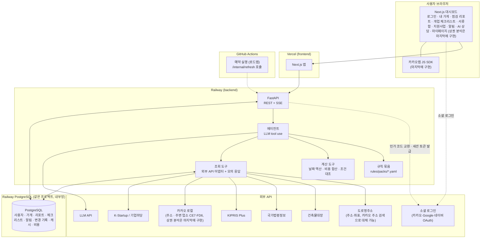
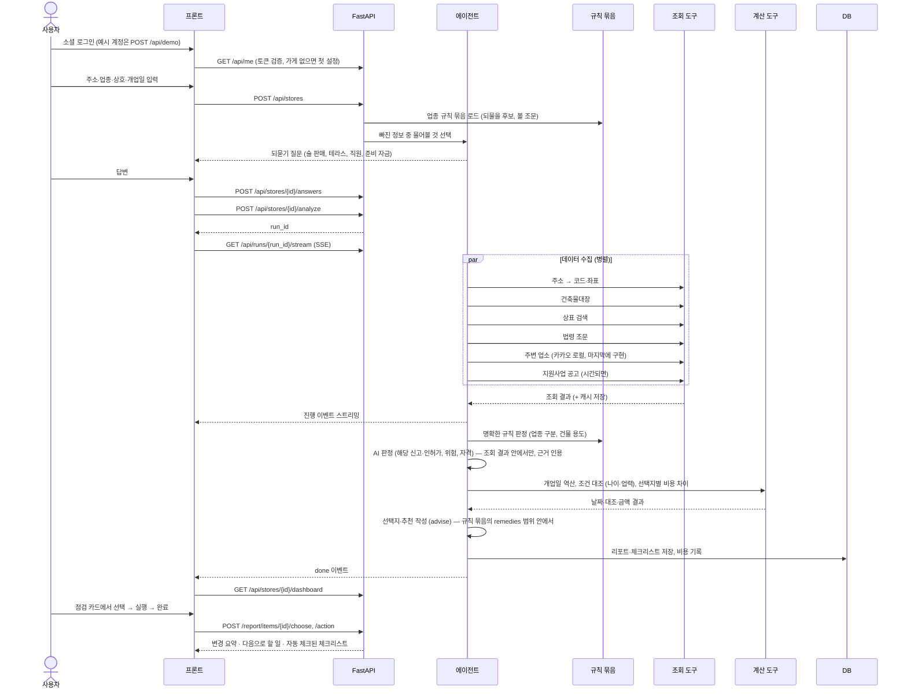
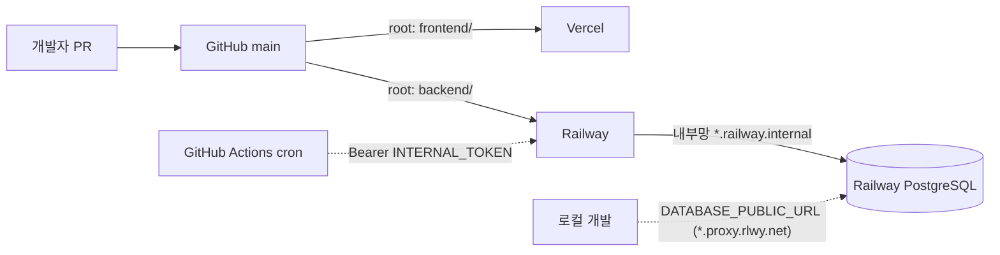
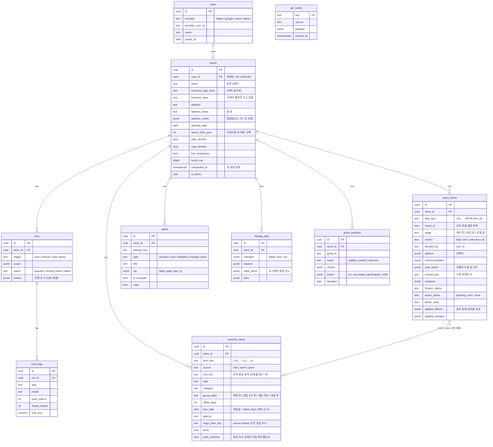

# 아키텍처, 인프라

# 청년 창업가 종합 솔루션 — 아키텍처 · 인프라

> 기준 문서: 기획서(청년 창업가를 위한 종합 솔루션), 예선 마감 2026-11-23(월) 17:00
시연 업종: 카페·음식점 / 팀 4명 / 모노레포(frontend, backend)
API 명세는 별도 문서 `API명세서.md`, DB 테이블·컬럼은 `DB 명세서.md` 참고
> 

### 변경 이력

| 날짜 | 내용 |
| --- | --- |
| 2026-11-17 | 최초 작성 |
| 2026-11-19 | 배포 구성을 **Vercel + Railway + Railway PostgreSQL**로 변경 (Render·Supabase 대체). 인프라 구성·배포 구조·리스크·환경변수·확인 목록 갱신 |
| 2026-11-20 (2차) | 프로토타입 `foundy` 확정 반영: **서류함은 받는 곳 안내만**(서류 생성·`document_states`·준비 체크 제거, `documents`는 받는 곳 링크·찾는 방법·`contact`), 결과 카드의 **문의 문구·특약·서류 초안(`prepared`·`drafts`) 제거**(기관 전화번호와 통화 질문 `call_questions`로 대체), **상권 분석(카카오 로컬)·메뉴 광고 문구는 마지막에 구현**해 현재 범위에서 제외. 데이터 모델 상세는 `DB 명세서.md`로 분리 |
| 2026-11-19 | 프로토타입(`foundy`) 반영: **소셜 로그인과 계정별 소유**(`users`·`stores.user_id`, 인증 서비스), **마이페이지**(영향 분석·카드 초기화·부분 재분석, `change_logs`), 점검 카드 **결정 → 실행 → 완료**(`action_status`)와 **다음으로 할 일**·**체크리스트 자동 체크**, 알림 유형 확장·`cta`·시점 이동 시연, **상권 분석**(카카오 로컬, 입지를 정한 사용자만 대상)으로 지도·후보 자리 구조 교체(`sites` 테이블·`compare_sites` 제거), AI 상담 확장(`kind`·`contacts`·통화 준비), 기관 전화번호(`contact`), 규칙 묶음 `report_links`·`franchise_brands`·`contacts` |
| 2026-11-18 (3차) | 점검 리포트를 **"결과물 + 결정 한 번"** 구조(결론·안 하면 생기는 일·선택지·추천·대신 만든 결과물·사용자가 할 일 1개)로 변경. 선택지·초안 생성 단계(`advise`)와 `agent/advise.py`, 규칙 묶음의 `remedies`·`drafts`, 선택 적용 API(`/choose`), 데이터 모델 필드 추가 |
| 2026-11-18 (2차) | **지원사업 자격 판정 주체를 AI로 확정**(공고문 데이터 안에서 판정, 숫자 조건 대조만 계산 도구), 자격 값 `eligible / partial / unknown` 통일, API 명세서를 이 문서에 맞춰 전면 갱신 |
| 2026-11-18 | 판정 구조를 **AI 판정 + 계산 도구 + 규칙 묶음**으로 변경, 일정표·신고를 **개업 체크리스트**로 통합, **내 가게 챗봇**과 **입지·상권 지도·매물 비교** 추가, **대출 안내 제외**, 데이터 모델·폴더 구조·외부 API·환경변수 갱신 |

---

## 0. 구현 범위

| 표기 | 의미 |
| --- | --- |
| **[핵심]** | 예선 링크에서 실제 데이터로 동작해야 함 |
| **[시간되면]** | 핵심 완료 후 실제 데이터로 연결 |
| **[예시]** | 예시 데이터로 화면만 시연. 응답에 `is_example: true`, 화면에 "예시 데이터" 배지 |
| **[로드맵]** | 소개서·발표에만 등장, 구현하지 않음 |

| 기능 | 범위 |
| --- | --- |
| 소셜 로그인 + 계정별 데이터 (예시 계정 포함) | [핵심] |
| 가게 등록(첫 설정) + 되묻기 | [핵심] |
| 마이페이지: 가게 정보 수정 → 영향 분석 → 영향받는 카드 초기화 → 부분 재분석 | [핵심] |
| 점검 리포트 (건물 용도·위반건축물·상호 상표·영업신고 서류·표시 의무) | [핵심] |
| 서류함: 항목별 필요 서류와 받는 곳 공식 사이트 링크·찾는 방법·기관 전화번호 | [핵심] |
| 결과 카드: 선택지·추천·기관 전화번호·할 일 1개, 선택 적용 | [핵심] |
| 결정 → 실행 → 완료, 다음으로 할 일 자동 정리, 체크리스트 자동 체크 | [핵심] |
| 개업 체크리스트 (시기별·카테고리별·달력, 개업일 역산, `.ics`) | [핵심] |
| 내 가게 홈 + 알림 센터 (유형 탭·액션 버튼) | [핵심] |
| 예시로 해보기 / 예시 계정 (이서연 씨 사례) | [핵심] |
| AI 상담 (근거 칩, 확인 후 적용, 항목별 상담, 통화 준비) | [시간되면] |
| 지원사업 (AI 자격 판정, 포스터 카드, 필터·정렬·보기) | [시간되면] |
| 상권 분석 (주변 동종 업소 지도, 경쟁 강도, 눈여겨볼 점, 가격대), 메뉴·광고 문구 점검 | **마지막에 구현** (현재 범위 제외) |
| 다시 조회 → 바뀐 것만 알림 (수동 버튼) | [시간되면] |
| 알림 센터 시점 이동(개업 D-7·6개월 후) | [예시] |
| 예약 자동 재조회, 상권 모니터링, 폐업 안내, 다른 업종 | [로드맵] |
| 대출 안내, 입지 추천·후보 상권 비교·후보 자리 직접 입력·매물 비교 | 제외 (입지를 정한 사용자만 대상) |

> 우선순위: 핵심이 "예시 계정"으로 끝까지 동작한 뒤에 [시간되면]에 착수한다. 로그인·마이페이지가 [핵심]에 들어와 일정 위험이 커졌으므로, 마감 전에 부족하면 로그인은 시연용 계정으로 두고 [시간되면]을 먼저 줄인다.
> 

---

## 1. 전체 아키텍처



### 1-1. 처리 흐름: 데이터 수집 → AI 판정 → 알림



### 1-2. 판정 구조: AI 판정 + 계산 도구 + 규칙 묶음

기획서 방침대로 **판정은 AI가 한다**. 공고문 자격 조건이나 조문 적용은 글로 쓰여 있고 가게마다 사정이 달라서 미리 정한 규칙으로 다 담을 수 없기 때문이다. 다만 시연 중 틀리면 치명적인 두 가지는 보완한다.

- **답이 하나로 정해진 계산**(날짜, 금액 합산, 숫자 조건 대조)은 AI가 직접 하지 않고 **계산 도구**를 불러 결과를 받는다.
- **법에 명시된 명확한 구분**(주류 판매 → 일반음식점, 업종별 건물 용도)은 **규칙 묶음**이 판정하고, AI는 그 결과를 설명한다.

| 판단 | 주체 | 조건 |
| --- | --- | --- |
| 데이터 조회, 캐시 | 조회 도구 | 실패 시 캐시 → mock |
| 업종 구분 (주류 → 일반음식점) | 규칙 묶음 |  |
| 건물 용도 적합 여부 | 규칙 묶음 | 데이터에 표기가 없으면 "판단 불가" |
| 개업일 역산 날짜, 기한 계산 | 계산 도구 | 개업일 변경 시 즉시 재계산 |
| (마지막에 구현) 상권 지표(거리별 업소 수, 밀집도, 프랜차이즈 비율), 가격 구간(저가·중간·고가) | 계산 도구 | 카카오 조회 값·예시 가격 분포 기준 |
| 나이·업력 같은 숫자 조건 대조 | 계산 도구 | 조건 값은 AI가 공고문에서 추출 |
| 되물을 질문 고르기 | AI | 규칙 묶음의 후보 중 선택 |
| 내 가게에 해당하는 신고·인허가 판정 | AI | 규칙 묶음이 지정한 조문 범위 안에서, 근거 조문 인용 |
| 위반 소지 판정 (상호 유사성 등. 광고 문구는 마지막에 구현) | AI | 결과는 `low`(확인 권장) 이하 |
| 지원사업 자격 판정 (글로 된 조건) | AI | `eligible / partial / unknown`, 공고문 문장 인용 |
| 공고문·조문 요약, 상담 답변 문장 | AI | 숫자는 데이터·계산 결과 그대로 |
| 선택지 구성, 추천 이유, 쉬운 말 결론 | AI | 선택지 종류는 규칙 묶음의 `remedies` 안에서만. 기간·금액은 근거(규칙·계산·데이터)가 있을 때만 쓰고 없으면 "확인 필요" |
| 선택지의 금액·기간 차이 | 계산 도구 | 근거(규칙·계산·데이터)가 있을 때만. 없으면 "확인 필요" |
| 통화 준비(기관 전화번호, 물어볼 질문 목록) | 규칙 | 규칙 묶음 `call_questions`의 질문에 가게 정보를 채운다. 모르는 칸은 `[확인 필요]`. 문의 문구·특약·서류 초안은 만들지 않는다 |
| (마지막에 구현) 상권 지표 (동종 업소 수, 거리별 수, 밀집도, 경쟁 수준), 가격 구간 | 계산 도구 | 카카오 조회 값만 사용. 프랜차이즈 구분은 규칙 묶음의 브랜드 목록으로 분류 |
| (마지막에 구현) "이 자리에서 눈여겨볼 점" 문장 | 규칙 | 위 숫자에서 규칙 문장으로 생성 (AI 아님). 숫자는 조회·계산 값만 |
| 선택 적용 (`/choose`) | 코드 | 선택지의 `apply`를 가게 정보·기준 자리에 반영하고 필요하면 재분석 |
| 챗봇 답변, 조건 변경 해석, 통화 준비 스크립트 | AI | 이 가게의 근거 안에서만, 변경 전 사용자 확인. 근거(Evidence)는 AI가 쓰지 않고 코드가 인용한 항목에서 가져온다. 기관 전화번호는 AI가 만들지 않는다 |
| 기관 전화번호 (문의 카드, 체크리스트, 상담) | 규칙 묶음 | `contacts`. 확인하지 못하면 `phone: null` → "확인 필요", 예시면 `verified: false` |
| 마이페이지 수정의 영향 범위, 초기화할 카드 | 코드 | 바꾼 필드 → `impacts` → 영향받는 카드 (아래 1-3) |
| 다음으로 할 일 선택·정렬, 체크리스트 자동 체크 | 코드 | 새로 생긴 할 일 → 결정 대기 → 다른 카드의 직접 할 일 → 체크리스트. 연동은 규칙 묶음의 `report_links` |
| 알림 생성 (결정 필요·다음 할 일·마감·변경·지원사업) | 코드 | `cta`(이어질 화면)를 함께 만든다 |

> 공통 원칙: AI는 **조회한 데이터 안에서만** 판정하고, 판정마다 근거(조문·공고문 문장·데이터 원값)를 붙인다. 근거가 없으면 `unknown`으로 두고 관할 기관 확인을 안내한다.
> 

### 1-3. 마이페이지 수정과 다시 반영

사용자가 가게 정보를 바꾸면 **영향받는 점검만** 다시 돌린다. 영향 범위는 규칙(코드)이 정하고 AI는 관여하지 않는다.

| 바꾼 필드 | `impacts` | 다시 하는 일 | 초기화되는 카드 |
| --- | --- | --- | --- |
| `opening_date` | `dates` | 체크리스트 날짜만 계산 도구로 재계산 | 없음 |
| `name` | `trademark` | 상표 검색 | 상표 카드 |
| `address`, `address_detail`, `business_type_input`, `sells_alcohol` | `building`, `law`, `checklist` (+ `market`은 상권 분석을 붙일 때) | 건축물대장·조문 조회, 체크리스트 재구성 | 건물 용도·위반건축물·영업신고 카드 |
| `uses_terrace`, `has_employees` | `law`/`checklist` | 옥외영업 점검, 고용 카테고리 | 영업신고 카드 |
| (마지막에 구현) `menu_text` | `ad` | 광고 문구 점검 | 광고 문구 카드 |
| `owner_birth_year` | `grants` | 지원사업 자격 판정 | 없음 |
| `funds_krw` | `costs` | 비용 계산 | 없음 |

- 카드 초기화: `chosen_option`, `action_status`, `action_reply`를 지우고 그 카드로 생긴 `checklist_items`(`source: report`)와 `auto_checked`를 되돌린다. 사용자가 직접 한 체크는 유지한다. 지운 카드는 응답의 `reset_items[]`로 알리고, 프론트는 저장 전에 미리 보여 준다.
- 다시 돌릴 단계(`scope`)는 `impacts`에서 만든다. 개업일만 바뀌면 외부 조회·LLM 호출이 없다. 변경 내용은 `change_logs`에 남고 알림(`change`)이 생긴다.
- 선택으로 바뀐 값(예: "술 빼고 시작"이 만든 `sells_alcohol=false`)은 카드에 붙은 **적용 효과**로 계산해 가게 정보에 덧씌운다. 마이페이지는 이 효과가 반영된 값을 보여 준다. 사용자가 그 값을 직접 바꾸면 해당 카드를 초기화하고 값을 저장한다.

---

## 2. 백엔드 내부 구조

```
backend/
├── main.py                    # FastAPI 앱, 라우터 등록, CORS
├── api/                       # 라우터 (API 명세서의 엔드포인트)
│   ├── auth.py                # 소셜 로그인, /me (토큰 검증·가게 소유 확인)
│   ├── stores.py              # 가게 등록(첫 설정)·되묻기, 마이페이지 수정(PATCH, impacts·reset_items), 변경 기록, 대시보드
│   ├── runs.py                # 분석 실행 + SSE
│   ├── report.py              # 점검 리포트, 선택지 적용(/choose), 실행 상태(/action) → 다음 할 일·자동 체크
│   ├── checklist.py           # 개업 체크리스트 (필요 서류 `documents[]` 포함)
│   ├── documents.py           # 서류함 (체크리스트 항목별 받는 곳 안내, 읽기 전용)
│   ├── chat.py                # AI 상담: 근거 칩·변경 제안(actions)·통화 준비(질문 목록은 규칙 묶음)·오늘 뭐부터
│   ├── market.py              # (마지막에 구현) 상권 분석 (지도 마커·요약·경쟁 강도, 가격대[예시])
│   ├── grants.py              # 지원사업
│   ├── alerts.py              # 알림(유형·cta·as_of), 다시 조회
│   ├── demo.py                # 예시로 해보기·예시 계정, 헬스체크
│   └── internal.py            # 예약 재조회 (토큰 보호)
├── agent/
│   ├── loop.py                # 에이전트 루프 (tool use)
│   ├── prompts/               # 되묻기, 판정, 선택지·추천, 요약, 상담 프롬프트
│   ├── judge.py               # AI 판정 + 근거 검증 (근거 없으면 unknown)
│   ├── advise.py              # 결과 카드 생성: 선택지·추천 (remedies 범위, 숫자는 계산 도구 결과)
│   ├── chat.py                # AI 상담: 근거 칩·변경 제안(actions)·통화 준비·오늘 뭐부터
│   └── cost.py                # 토큰·비용 기록
├── rules/
│   ├── engine.py              # 규칙 묶음 로드, 업종 구분·건물 용도 판정
│   └── packs/
│       └── cafe_restaurant.yaml   # 점검 항목, remedies, call_questions, 체크리스트, report_links, documents·sites, contacts (franchise_brands는 상권 분석 때)
├── calc/                      # 계산 도구 (AI가 tool로 호출)
│   ├── dates.py               # 개업일 역산, 기한 계산
│   ├── market.py              # (마지막에 구현) 상권 지표: 거리별 수, 밀집도, 경쟁 수준, 프랜차이즈 비율, 가격 구간
│   ├── documents.py           # 체크리스트 항목별 필요 서류·받는 곳 링크 조립, 서류함 집계(완료한 항목의 서류·남은 서류)
│   ├── impacts.py             # 마이페이지 수정의 영향 범위·초기화할 카드
│   ├── next_steps.py          # 다음으로 할 일 선택·정렬, 체크리스트 자동 체크
│   ├── costs.py               # (후보 자리 비교용이던 비용 합산. 현재 서비스 범위에서는 쓰지 않음)
│   └── match.py               # 나이·업력 등 숫자 조건 대조
├── tools/                     # 조회 도구 (각각 mock 대체 경로 포함)
│   ├── address.py
│   ├── building.py
│   ├── law.py
│   ├── trademark.py
│   ├── places.py              # (마지막에 구현) 카카오 로컬 (주변 업소 CE7·FD6, 주소 검색)
│   ├── grants.py              # K-Startup / 기업마당
│   └── cache.py
├── mocks/                     # 도구별 모의 응답 + 예시 데이터(시점 이동 알림. 가격 분포·지역 평균 임대료는 상권 분석 때)
├── db/
│   ├── models.py
│   └── migrations/
└── tests/scenarios/
```

### 2-1. AI 모듈과 백엔드의 인터페이스

AI 모듈(`agent/`)은 순수 파이썬 함수로 제공하고, 백엔드가 import해서 호출한다. 엔드포인트별 연결 방법과 저장 매핑은 `AI_모듈_연동_가이드.md`에 있다. 조회 도구와 계산 도구는 `agent/ports.py`의 Protocol(`Tools`, `Calc`, `ToolResult`)만 만족하면 되어서, 실제 구현이 없어도 가짜 객체로 양쪽이 독립 개발할 수 있다.

| 함수 | 입력 | 출력 | 쓰는 API |
| --- | --- | --- | --- |
| `select_questions(llm, pack, store)` | 가게 입력, 규칙 묶음 | 되물을 질문 (필수 질문은 항상 포함) | `POST /stores`, `/answers` |
| `run_analysis(store, tools=, calc=, llm=, emit=)` | 가게, 조회·계산 도구, SSE 이벤트 콜백 | `AnalysisResult` (리포트 항목, 체크리스트, 요약, 비용) | `POST /analyze`, SSE |
| `chat(llm, ctx, message, history, focus)` | 이 가게의 저장된 결과(`ChatContext`: 가게, 리포트 항목, 체크리스트), 대화 기록, 질문 대상 | `ChatReply` (답변, 근거, 제안 동작, 안내 문구) | `POST /chat` |
| `judge_grants(llm, store, tools_result, today)` | 가게, `tools.grants(store)` 결과 | `GrantsResult` (자격 판정한 공고, 제외·마감 건수) | `GET /grants` |

- 백엔드가 구현할 것: `tools.building(store)`, `tools.trademark(name)`, `tools.law(check_id)`, `calc.checklist_dates(opening_date, week)`, `calc.site_cost_delta(base, other)`. 반환 형태는 `agent/ports.py` 상단 주석에 있다. 조회 실패는 예외 대신 `ToolResult(ok=False)`로 돌려준다.
- `emit(event, data)`로 `step` / `item` / `done` 이벤트가 나온다. 백엔드가 `run_id`를 붙여 SSE로 내보내고, 결과 `AnalysisResult`를 DB에 저장한다.
- 예시로 해보기(`POST /api/demo`)의 저장 결과는 `backend/mocks/demo/seoyeon.json`이다. 되묻기 질문, 진행 이벤트(재생용), 리포트 항목, 체크리스트가 들어 있어서 백엔드는 이 파일을 복사해 새 `store_id`로 만들면 된다. 입력은 `seoyeon_inputs.json`이고, `scripts/build_demo.py`로 다시 만든다. 데모 시나리오 S1~S4는 `backend/tests/scenarios/`에 고정돼 있다.
- 지원사업은 `run_analysis(..., include_grants=True)`로 함께 돌리거나 `judge_grants`를 따로 호출한다. AI가 공고문에서 조건을 인용과 함께 뽑고, 나이·업력·지역 대조는 `calc/match.py`가 한다. 인용이 공고문 원문에 없으면 `unknown`이고, 조건이 명확히 맞지 않는 공고는 목록에서 뺀다. 마감일은 `calc.date_info`로 체크리스트(정책)에 추가한다.
- **후보 자리 비교는 서비스 범위에서 제외했다** (입지를 정한 사용자만 대상). `agent/location.py`의 `compare_sites`와 `calc/costs.py`의 비용 비교는 더 이상 API에서 부르지 않는다 (삭제 여부는 팀 결정). 이전 설계: 금액·㎡당 임대료·버틸 수 있는 기간을 `calc/costs.py`가 계산하고, AI 요약에 제공된 값에 없는 숫자가 있으면 그 요약을 버리고 규칙 요약으로 대체한다. 데이터가 없는 상권 지표는 `available: false` 그대로 둔다.
- 챗봇은 근거를 AI가 쓰지 않는다. AI가 인용할 항목 id를 고르면 코드가 그 항목의 근거를 붙이고, 근거를 댈 수 없는 사실 답변은 "판단 불가"로 바꾼다. 조건 변경은 `actions`로 제안만 하고(`requires_confirm`), 값과 id는 코드가 검증한다. 대화 기록은 백엔드가 매번 넘기며 서버에 저장하지 않는다.
- **AI 상담의 프로토타입 기능 중 현재 `agent/chat.py`에 없는 것**: 응답 `kind` 구분(`grounded/change/oos/chitchat`)과 변경 제안의 `summary[]`(전→후), `contacts[]`(범위 밖 질문의 기관 전화번호, 규칙 묶음에서), `call_prep`(통화 준비 스크립트·질문), "오늘 뭐부터" 요약, 추천 질문(`suggestions`). 기관 번호·추천 질문·정렬은 코드로, 스크립트와 답변 문장만 LLM으로 만든다. 추가 구현 항목은 `AI_모듈_연동_가이드.md` 4-7에 있다.
- 순서가 고정된 파이프라인이다: 조회 → 규칙 판정 → AI 판정 → 결과 카드 → 체크리스트. 도구가 실패해도 해당 항목을 `unknown`으로 두고 끝까지 진행한다.

---

## 3. 인프라

### 3-1. 구성

| 구성 요소 | 서비스 | 플랜 | 역할 |
| --- | --- | --- | --- |
| 프론트 | Vercel | 무료 | Next.js 배포, `main` 머지 시 자동 배포 |
| 백엔드 | Railway 서비스 (Root Directory `backend/`) | 요금제·크레딧 확인 필요 | FastAPI, 에이전트, SSE. 시작 명령 `uvicorn main:app --host 0.0.0.0 --port $PORT` |
| DB | Railway PostgreSQL (같은 프로젝트) | 요금제·크레딧 확인 필요 | 사용자·가게·결과·알림·변경 기록·캐시 저장 (컨테이너 파일시스템은 재배포 시 사라지므로 DB 필수). 백엔드는 내부망 주소(`*.railway.internal`)로 접속 |
| 인증 | 소셜 로그인(OAuth) + 백엔드가 발급하는 세션 토큰(JWT) | 무료 | 카카오·Google·네이버 인가 코드를 백엔드가 교환하고 자체 토큰을 발급한다. 사용자는 PostgreSQL `users`에 저장하고, 백엔드는 토큰의 `user_id`로 가게 소유를 확인한다 |
| 지도 | 카카오맵 JS SDK, 카카오 로컬 REST | 무료 한도 내 (개발자 계정의 첫 앱에만 무료) | **상권 분석을 붙일 때(마지막에 구현) 쓴다.** 지도 표시는 프론트에서 직접 로드, 주변 업소 검색은 백엔드가 호출. 주소 검색은 지금도 쓸 수 있다 |
| 예약 실행 | GitHub Actions `schedule` | 무료 | 하루 1회 `/internal/refresh` 호출 (로드맵) |
| 비밀값 | Vercel / Railway 환경변수 | — | 저장소에는 `.env.example`만. `DATABASE_URL`은 Railway 참조 변수 `${{Postgres.DATABASE_URL}}`로 연결 |
| 코드 리뷰 | CodeRabbit | — | `.coderabbit.yaml` |

### 3-2. 배포 구조



### 3-3. 인프라 리스크와 대응

| 리스크 | 영향 | 대응 |
| --- | --- | --- |
| Railway 크레딧 소진 또는 서버 슬립 설정 | 심사 기간에 서버가 멈추거나 첫 접속이 느림 | 요금제·남은 크레딧을 심사 전에 확인, 서버 슬립(Serverless) 설정은 끈다. 시작 화면에서 `/api/health` 선호출 + "서버 준비 중" 안내는 유지 |
| 국가법령정보 OC의 IP 등록 | 배포 서버에서 조문 조회 차단 가능 | 배포 직후 Railway 서버에서 `scripts/api_probe/probe_law.py` 실행. 아웃바운드 IP가 고정이 아니면 OC 등록이 어려우므로 고정 IP 제공 여부(요금제) 확인, 안 되면 시연 조문 사전 캐시 + mock |
| 로컬에서 DB 접속 실패 | 개발 중 DB 기능 테스트 불가 | 내부 주소(`*.railway.internal`)는 Railway 안에서만 열린다. 로컬 `.env`에는 `DATABASE_PUBLIC_URL` 값을 넣는다 |
| 외부 API 장애·한도 초과 | 리포트 생성 실패 | 모든 도구에 mock 대체, `api_cache` 재사용, "예시로 해보기"는 저장된 결과로 동작 |
| AI 판정 오류 | 잘못된 위험 안내 | 명확한 구분은 규칙 묶음, 계산은 계산 도구, AI 판정은 근거 인용 필수·근거 없으면 `unknown`, 데모 시나리오로 회귀 확인 |
| (마지막에 구현) 지도 SDK 도메인 등록·한도 | 지도 화면 안 뜸 | Vercel 배포 도메인을 카카오 콘솔에 등록, 실패 시 지도 없이 상권 요약·경쟁 강도 표만 표시 |
| 소셜 로그인 리다이렉트 URI·앱 심사 | 로그인이 안 돼 심사위원이 진입 못 함 | 배포 도메인을 각 소셜 앱의 리다이렉트 URI에 등록, **로그인 없이 쓰는 "예시 계정"(`POST /api/demo`)을 항상 열어 둔다**. 실제 소셜 로그인 승인이 늦으면 시연용 계정으로 대체 |
| 다른 계정 데이터 노출 | 개인정보 유출 | 모든 `/stores/{id}/*`에서 토큰의 `user_id`와 `stores.user_id`를 비교(`403`) |
| SSE가 중간에 끊김 | 진행 화면 멈춤 | 결과는 DB에 저장되므로 `GET /api/runs/{id}`로 폴링 대체 |
| LLM 비용 증가 | 예산 초과 | 단계별 모델 분리, 같은 공고·조문 판정 결과 캐시, `cost_logs`로 실측 |

### 3-4. 환경변수

| 변수 | 위치 | 설명 |
| --- | --- | --- |
| `NEXT_PUBLIC_API_BASE_URL` | frontend | 백엔드 주소 |
| `NEXT_PUBLIC_MAP_JS_KEY` | frontend | 카카오맵 JavaScript 키 (상권 분석을 붙일 때. 도메인 제한으로 보호) |
| `OAUTH_KAKAO_CLIENT_ID`, `OAUTH_KAKAO_CLIENT_SECRET`, `OAUTH_GOOGLE_CLIENT_ID`, `OAUTH_GOOGLE_CLIENT_SECRET`, `OAUTH_NAVER_CLIENT_ID`, `OAUTH_NAVER_CLIENT_SECRET` | backend | 소셜 로그인 앱 키 (리다이렉트 URI에 배포 도메인 등록) |
| `JWT_SECRET` | backend | 세션 토큰 서명·검증 |
| `KAKAO_REST_API_KEY` | backend | 카카오 로컬 (주소 검색. 주변 업소 CE7·FD6는 상권 분석을 붙일 때) |
| `DATABASE_URL` | backend | Railway PostgreSQL 연결 문자열. 배포는 `${{Postgres.DATABASE_URL}}`(내부망), 로컬은 `DATABASE_PUBLIC_URL` 값 |
| `FRONTEND_ORIGIN` | backend | CORS 허용 출처 |
| `LLM_API_KEY`, `LLM_MODEL_FAST`, `LLM_MODEL_MAIN` | backend | 되묻기·요약용 / 판정·상담용 모델 |
| `JUSO_API_KEY`, `JUSO_COORD_API_KEY` | backend | 도로명주소 검색 / 좌표 (카카오 주소 검색으로 대체하면 불필요) |
| `DATA_GO_KR_KEY` | backend | 공공데이터포털 서비스키 (건축물대장, K-Startup) |
| `LAW_OC` | backend | 국가법령정보 OC |
| `KIPRIS_API_KEY` | backend | KIPRIS Plus |
| `BIZINFO_API_KEY` | backend | 기업마당 |
| `USE_MOCK` | backend | `true`면 모든 조회 도구가 모의 응답 사용 |
| `INTERNAL_TOKEN` | backend, GitHub Secrets | 예약 재조회 엔드포인트 보호 |

---

## 4. 데이터 모델 (PostgreSQL)

> **컬럼·제약·상태 전이·트랜잭션은 `DB 명세서.md`가 기준이다.** 이 장은 구조 요약만 둔다.



- **로그인**: 소셜 로그인으로 계정을 만들고(`users`), 가게는 `stores.user_id`로 소유한다. 모든 `/stores/{id}/*`는 토큰의 `user_id`와 `stores.user_id`를 비교한다. 로그아웃하면 토큰만 지우고 데이터는 계정에 남는다. **예시 계정**(`provider: demo`)은 가입 없이 `POST /api/demo`로 만들고 저장된 결과를 복사해 쓴다.
- **후보 자리(`sites`) 테이블은 없다.** 입지를 정한 사용자의 주소 하나가 기준이다.
- **서류 테이블이 없다.** 서류 목록·받는 곳 링크·찾는 방법은 규칙 묶음(`documents`·`sites`)으로 만들고, 서류함 요약은 `checklist_items.done`으로 센다. 서류를 대신 만들거나 서류별 준비 여부를 저장하지 않는다.
- **원본 보존**: 선택지가 바꾸는 값(술 빼기, 이름 바꾸기)은 `stores`를 고치지 않고 `report_items.applied_effects`에 둔다. 유효 값 = `stores` + 선택된 카드의 효과. 카드를 초기화하면 원본으로 돌아간다.
- 챗봇 대화 기록은 저장하지 않고 프론트가 `history`로 보낸다. 통화 메모는 카드의 `action_reply`, 조건 변경은 `stores`·`change_logs`에 남는다.
- 알림은 서버가 상태에서 만들어 저장한다 (`dedupe_key`로 중복 방지): 결정 대기 카드(`decision`), 카드를 `sent`·`done`으로 바꿀 때(`next`, 되돌리면 삭제), 마이페이지 수정(`change`), 기한·마감(`deadline`), 새 공고(`grant`). 시점 이동(`as_of`)의 예시 알림은 저장하지 않고 `mocks/`에서 읽는다.
- 점검 카드를 초기화하면 그 카드로 생긴 `checklist_items`(`source: report`)와 자동 체크를 되돌린다 (1-3).
- **상권 분석(마지막에 구현)**: 테이블을 추가하지 않는다. 주변 업소는 `stores.address_codes`의 좌표로 카카오 로컬을 호출해 `api_cache`(`source: places`, 7일)에 둔다. 가격 분포·지역 평균 임대료 같은 예시 데이터는 DB에 넣지 않고 `mocks/`에서 읽어 `is_example: true`를 붙인다. 추가 컬럼은 `DB 명세서.md` 10장.

---

## 5. 외부 API 연동

| 도구 | 외부 API | 쓰는 정보 | 캐시 만료 | 상태 |
| --- | --- | --- | --- | --- |
| `address` | 행정안전부 도로명주소 검색 / 좌표 API (또는 카카오 주소 검색) | 법정동코드, 번·지, 좌표 | 30일 | 카카오 주소 검색 하나로 법정동코드·번·지·좌표를 모두 얻을 수 있음 (호출 확인 완료) |
| `building` | 국토부 건축HUB 건축물대장 (표제부, 층별개요) | 주용도, 층별 용도·면적, 사용승인일 | 7일 | **위반건축물 표기는 응답에 없음(확인 완료)** → `building_violation = unknown` + 열람 안내 |
| `law` | 국가법령정보 공동활용 (OC) | 조문 원문, 시행일, 링크 | 1일 | **배포 서버 IP 등록 확인 필요** |
| `trademark` | KIPRIS Plus 상표 | 유사 상표, 분류, 상태 | 7일 | 키 승인 시간 확인 필요 |
| `places` | **카카오 로컬** 카테고리 검색 (카페 CE7, 음식점 FD6) — **마지막에 구현** | 반경 내 업소 이름·거리·좌표·`place_url`, 총 개수 | 7일 | **호출 확인 완료** (반경 300m 카페 총 54곳 중 목록은 최대 45건). 개폐업 추이·유동인구·메뉴·가격은 없음 → "데이터 없음" / [예시] |
| `grants` | K-Startup 사업공고, 기업마당 지원사업 | 공고 제목, 기간, 대상, 원문 링크, (있으면) 포스터 이미지·첨부 | 1일 | 응답 필드(특히 이미지·첨부) 확인 필요. 없으면 포스터형 카드로 대체 |
| (프론트) | 카카오맵 JS SDK | 지도 표시, 마커 | — | **카카오로 확정** (네이버는 쓰지 않음). 상권 분석과 함께 마지막에 구현. 배포 도메인 등록 필요 |
| (인증) | 카카오·Google·네이버 OAuth | 인가 코드 교환, 사용자 식별 | — | 앱 등록·리다이렉트 URI(배포 도메인)·앱 심사 확인 필요 (예시 계정은 항상 열어 둔다) |
| (예시·마지막에 구현) | 한국부동산원 상업용부동산 임대동향 | 지역 평균 임대료 | — | 제공 단위(상권·분기)와 가져오는 방법 확인 전까지 [예시] |
| (예시·마지막에 구현) | 없음 | 주변 가게 메뉴·가격 분포 | — | 공개 데이터 없음 → [예시]. 화면에서 `place_url` 링크로만 연결 |

> 민간 상권 서비스(예: 오픈업)의 데이터는 약관상 재배포·상업적 재가공이 금지되어 있어 쓰지 않는다. 필요하면 화면에서 외부 링크로만 연결한다.
> 

### 도구 공통 인터페이스

```python
class ToolResult(BaseModel):
    ok: bool
    source: str            # "건축물대장 층별개요"
    data: dict | None
    fetched_at: datetime
    from_cache: bool
    from_mock: bool        # True면 SSE에 fallback 이벤트, 응답 evidence에 표시
    error: str | None
```

- 실패 순서: 실제 API → 캐시(만료돼도 사용) → mock. 어느 단계든 `from_cache`/`from_mock`을 기록한다.
- 타임아웃: 외부 API 5초, LLM 30초.

---

## 6. 규칙 묶음 (업종 확장의 단위)

에이전트·조회 도구·계산 도구는 업종과 무관하게 공통이다. 업종마다 달라지는 것은 규칙 묶음 하나다.

`rules/packs/cafe_restaurant.yaml` 구조 (요약)

```yaml
pack: cafe_restaurant
ask: [sells_alcohol, uses_terrace, has_employees, funds_krw]   # 되물을 후보
derive:                                                        # 규칙으로 정하는 값
  business_type: "sells_alcohol ? 일반음식점 : 휴게음식점"
checks:                                                        # 점검 리포트 항목, 볼 조문, 가능한 대응
  - id: building_use
    remedies: [change_business_type, request_use_change, find_other_site]   # 선택지로 만들 수 있는 대응 유형
    contact: building                                                       # 카드에 보여줄 기관 (contacts의 키)
    call_questions:                                                         # 통화 준비 질문 ({biz}는 신고 업종으로 채움)
      - "이 건물 해당 층의 용도가 {biz} 영업신고에 적합한가요?"
      - "위반건축물로 등재돼 있지는 않은가요?"
      - "용도가 맞지 않는다면 용도변경이 가능한지, 필요한 서류와 절차가 무엇인가요?"
      - "답변을 문자나 공문으로도 받을 수 있을까요?"
  - id: building_violation
    remedies: []
    contact: building
    call_questions: [...]
  - id: trademark_similar
    remedies: [rename_store, proceed]
  - id: permit_docs
    remedies: []
    contact: hygiene
    call_questions: [...]
  - id: labeling                                                 # 운영 중 표시 의무 (일반 안내)
    remedies: []
  # ad_claims (메뉴·광고 문구, remedies: [rewrite_copy, proceed])는 마지막에 구현
checklist:                                                     # 개업 체크리스트 기본 항목 (group·offset_days는 항목마다 고정)
  - { id: c-01, task: 건축물대장 확인 및 임대차 계약 검토, category: 건물·시설, group: 계약 전, offset_days: -56, agency: 관할 구청 건축과 }
  - { id: c-02, task: 상호·상표 유사 여부 추가 확인, category: 간판·광고, group: 계약 전, offset_days: -49, agency: KIPRIS }
  - { id: c-03, task: 사업자등록 신청, category: 세무, group: 개업 4주 전, offset_days: -28, agency: 홈택스 또는 세무서 }
  - { id: c-04, task: 영업 신고에 필요한 서류 준비, category: 영업 인허가, group: 개업 4주 전, offset_days: -28, agency: 관할 구청 위생과 }   # 제목 앞에 신고 업종이 붙는다
  - { id: c-05, task: 식품위생교육 이수, category: 영업 인허가, group: 개업 4주 전, offset_days: -22, agency: 관련 교육기관 }
  - { id: c-06, task: 건강진단결과서 준비, category: 영업 인허가, group: 개업 직전, offset_days: -10, agency: 보건소 등 }
  - { id: c-07, task: 간판 설치 관련 기준 확인, category: 간판·광고, group: 개업 직전, offset_days: -6, agency: 관할 구청 }
  - { id: c-08, task: 근로계약서 및 고용 관련 사항 확인, category: 고용, group: 개업 직전, offset_days: -3, agency: 고용노동부 안내, when: has_employees }
  - { id: c-09, task: 운영 중 표시 의무 사항 점검, category: 표시 의무, group: 개업 후, offset_days: 7, agency: 관할 기관 }
extra_tasks:                                                   # 선택지로 생기는 항목 (점검 카드를 되돌리면 사라진다)
  - { id: x-0, task: 용도가 맞는 다른 후보 자리 알아보기, category: 건물·시설, group: 계약 전, offset_days: -70, agency: 본인 확인, from: [building_use, find_other_site] }
  - { id: x-1, task: 구청 건축과에 용도변경 가능 여부 문의, category: 건물·시설, group: 계약 전, offset_days: -60, agency: 관할 구청 건축과, from: [building_use, request_use_change] }
  - { id: x-2, task: 간판 제작 전 상표 최종 확인 (KIPRIS), category: 간판·광고, group: 계약 전, offset_days: -30, agency: KIPRIS, from: [trademark_similar, proceed] }
report_links:                                                  # 점검 카드 ↔ 체크리스트 자동 체크 (연결된 카드가 모두 완료되면 항목 자동 체크)
  - { task: c-01, cards: [building_use, building_violation] }
  - { task: c-02, cards: [trademark_similar] }
  - { task: c-04, cards: [permit_docs] }
  - { task: x-0, cards: [building_use] }
  - { task: x-1, cards: [building_use] }
  - { task: x-2, cards: [trademark_similar] }
impacts:                                                       # 마이페이지에서 바꾼 필드 → 다시 할 일 → 초기화할 카드
  name: { run: [trademark], reset: [trademark_similar] }
  address: { run: [building, law, checklist], reset: [building_use, building_violation, permit_docs] }
  sells_alcohol: { run: [building, law, checklist], reset: [building_use, building_violation, permit_docs] }
  opening_date: { run: [dates], reset: [] }
documents:                                                     # 체크리스트 항목별 필요 서류 = 받는 곳 안내 (서류를 만들어 주지 않는다)
  - task: 영업신고 서류 준비
    docs:
      - { id: apply, name: 영업신고 접수, agency: 정부24 · 관할 구청 위생과, guide: "정부24에서 영업신고를 검색해 신청하거나 관할 구청 위생과에 직접 제출", sites: [gov24], contact: hygiene }
  - task: 건축물대장 확인 및 임대차 계약 검토
    docs:
      - { id: bldg, name: 건축물대장 (일반·집합), agency: 정부24 · 세움터, guide: "...", sites: [gov24, eais] }
sites:                                                         # 공식 사이트 (첫 화면 주소만. 사람이 확인한 것만)
  gov24: { label: 정부24, url: "https://www.gov.kr/" }
  eais: { label: 세움터 (건축행정시스템), url: "https://www.eais.go.kr/" }
  hometax: { label: 홈택스, url: "https://www.hometax.go.kr/" }
  kipris: { label: KIPRIS (특허정보검색서비스), url: "https://www.kipris.or.kr/" }
  moel: { label: 고용노동부, url: "https://www.moel.go.kr/" }
  insure: { label: 4대사회보험 정보연계센터, url: "https://www.4insure.or.kr/" }
  naqs: { label: 국립농산물품질관리원, url: "https://www.naqs.go.kr/" }
# franchise_brands: [빽다방, 이디야, ...]   # 상권 분석의 프랜차이즈 분류 — 마지막에 구현
contacts:                                                      # 기관 전화번호 (AI가 만들지 않는다. 확인 못 하면 null)
  building: { agency: 관할 구청 건축과, phone_by_sigungu: {...}, verified: false }
  hygiene:  { agency: 관할 구청 위생과, phone_by_sigungu: {...}, verified: false }
  tax:      { agency: 국세상담센터, phone: "126", verified: true }
  labor:    { agency: 고용노동부 상담센터, phone: "1350", verified: true }
  general:  { agency: 정부민원안내콜센터, phone: "110", verified: true }
```

- `remedies`는 항목별로 선택지로 만들 수 있는 대응 유형이다. AI는 이 범위 안에서만 선택지를 만들어 법적 근거 없는 대응을 지어내지 않는다. `find_other_site`("다른 자리를 알아보기")는 주소를 바꾸는 선택지가 아니라 **체크리스트에 "용도가 맞는 다른 후보 자리 알아보기"를 추가하고 점검 결과는 그대로 두는** 안내형 대응이다. 새 주소는 마이페이지에서 바꾸면 점검이 다시 돌아간다. 후보 자리를 서비스 안에서 비교하지 않는다.
- 규칙 묶음은 "무엇을 볼지"를 정하고, 각 항목이 이 가게에 해당하는지와 위험한지는 AI가 조회 결과를 근거로 판정한다. 날짜는 계산 도구가 `opening_date + offset_days`로 계산하고, 시기(`group`)는 항목마다 적힌 값을 쓴다.
- `required: true`인 질문(예: 주류 판매 여부)은 AI가 되묻기에서 빼도 항상 묻는다. `titles`는 점검 항목의 판정별 제목 템플릿, `checklist_task`는 그 항목이 걸렸을 때 연결되는 체크리스트 기본 항목이다.
- 실제 순서·기간과 조문 번호는 D 담당이 사전조사로 확정한 뒤 반영한다.
- `documents`는 체크리스트 항목별 필요 서류와 받는 곳, `sites`는 받는 곳 링크 목록이다. **링크는 사람이 확인한 공식 사이트 첫 화면 주소만 쓰고**, 세부 신청 페이지 주소는 바뀌기 쉬워 쓰지 않는다(찾는 방법은 `guide` 문구로 안내). 서류를 대신 만들거나 준비 여부를 저장하지 않는다. `call_questions`는 점검 항목별 통화 질문 목록이다.
- `report_links`는 점검 카드와 체크리스트 항목의 연결, `contacts`는 기관 전화번호(관할 구청 번호는 주소의 시군구 기준이고 확인하지 못하면 `null`) 모두 업종마다 달라질 수 있어서 규칙 묶음에 둔다.
- 새 업종 = 이 파일 하나 추가. 에이전트·도구·API 코드는 바뀌지 않는다.

---

## 7. 역할별 담당 (4명)

| 역할 | 담당 범위 |
| --- | --- |
| A. 에이전트·LLM | `agent/`, 되묻기·판정·선택지·추천·요약·상담 프롬프트, 근거 검증, `/chat`, 비용 기록 |
| B. 데이터 도구·DB·인증 | `tools/`, `calc/`(날짜·영향 분석·다음 할 일·서류 집계), `mocks/`, `api_cache`, PostgreSQL 스키마(Railway, `DB 명세서.md`), 소셜 로그인·세션 토큰·소유 확인, 외부 API 확인 |
| C. 프론트·배포 | 화면(로그인, 첫 설정, 조사 중, 내 가게 홈, 리포트, 체크리스트(달력), 서류함, 알림 센터, 지원사업, AI 상담, 마이페이지. 상권 분석·카카오맵 SDK는 마지막에), SSE, 소셜 로그인 연결, Vercel·Railway 배포 |
| D. 규칙·문서 | `rules/`(점검 항목, 체크리스트, `report_links`, `documents`·`sites`, `contacts`, `call_questions`), 데모 시나리오 테스트, 예시 데이터 작성, 소개서·AI 활용내역·영상 |

API 계약(`API명세서.md`)을 확정하면 C는 mock JSON으로, A·B는 엔드포인트별로 병렬 개발할 수 있다.

---

## 8. 개발 전 확인 목록

- [x]  건축물대장 응답에 위반건축물 표기가 있는가 → **없음** (2026-11-18 확인, `docs/api_check_report.md`). `building_violation`은 항상 `unknown` + 세움터 열람 안내
- [ ]  법령 API가 Railway 서버에서 호출되는가 (IP 등록, 아웃바운드 IP 고정 여부). 로컬 IP에서는 동작 확인
- [x]  주변 업소 조회 → **카카오 로컬로 확정** (구현은 상권 분석과 함께 마지막에). 반경 300m 카페 총 54곳, 목록은 최대 45건. 개폐업·유동인구·메뉴·가격은 없음 → "데이터 없음" / [예시]
- [ ]  K-Startup·기업마당 공고 API의 대상·지역·연령 필드, **포스터 이미지·첨부 필드** 유무 → 이미지가 없으면 포스터형 카드로 대체, 조건 필드가 없으면 AI가 공고문에서 조건을 뽑고 `unknown` 허용
- [x]  지도 SDK는 카카오맵으로 확정 (네이버 제외, 상권 분석과 함께 마지막에). 남은 일: 무료 한도(개발자 계정의 첫 앱) 확인, 배포 도메인 등록
- [ ]  **소셜 로그인**: 카카오·Google·네이버 앱 등록과 리다이렉트 URI(배포 도메인), 앱 심사 소요 시간. 늦으면 시연용 계정으로 대체하고 예시 계정은 항상 열어 둔다
- [ ]  **계정별 접근 제어**: 모든 `/stores/{id}/*`에서 토큰의 `user_id`와 `stores.user_id` 비교(403)
- [ ]  기관 전화번호 데이터: 관할 구청(건축과·위생과) 번호를 시군구별로 어떻게 관리할지 (규칙 묶음 `contacts`), 확인 못 한 번호는 `phone: null`
- [ ]  **서류 받는 곳 링크 검증**: 정부24·홈택스·세움터·KIPRIS·고용노동부·4대사회보험 정보연계센터·국립농산물품질관리원 첫 화면 주소가 맞는지 사람이 확인한다 (`sites`). 지원사업 상세의 K-Startup·기업마당 링크도 함께 확인
- [ ]  (마지막에 구현) 지역 평균 임대료 원천(한국부동산원 임대동향 등)의 제공 단위와 가져오는 방법 → 확인 전까지 [예시]
- [ ]  Railway 요금제·크레딧이 심사 기간(예선 마감 이후 심사 종료까지) 버티는지, 서버 슬립 설정이 꺼져 있는지
- [ ]  Railway 백엔드 서비스에 `DATABASE_URL=${{Postgres.DATABASE_URL}}` 참조 변수 연결, 로컬은 `DATABASE_PUBLIC_URL` 사용
- [x]  API 명세서를 이 문서 기준으로 갱신 (2026-11-19 프로토타입 반영 완료)
- [ ]  `docs/report-schema.json`을 API 명세서 형식으로 갱신 (`action_status`·`linked_task_ids` 등 일부만 반영된 상태, 나머지는 백엔드와 확정), `CLAUDE.md`의 판정 원칙("규칙으로 판단할 수 있는 것은 코드")·폴더 구조(`api/`, `calc/`, `db/`, `rules/packs/`)·범위 규칙("로그인은 범위 밖")을 이 문서에 맞게 수정
