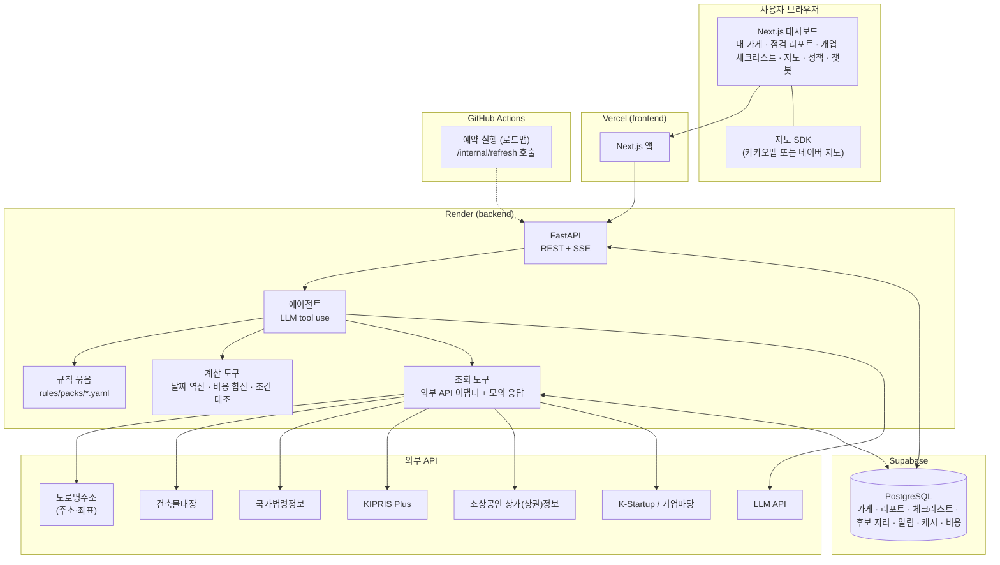
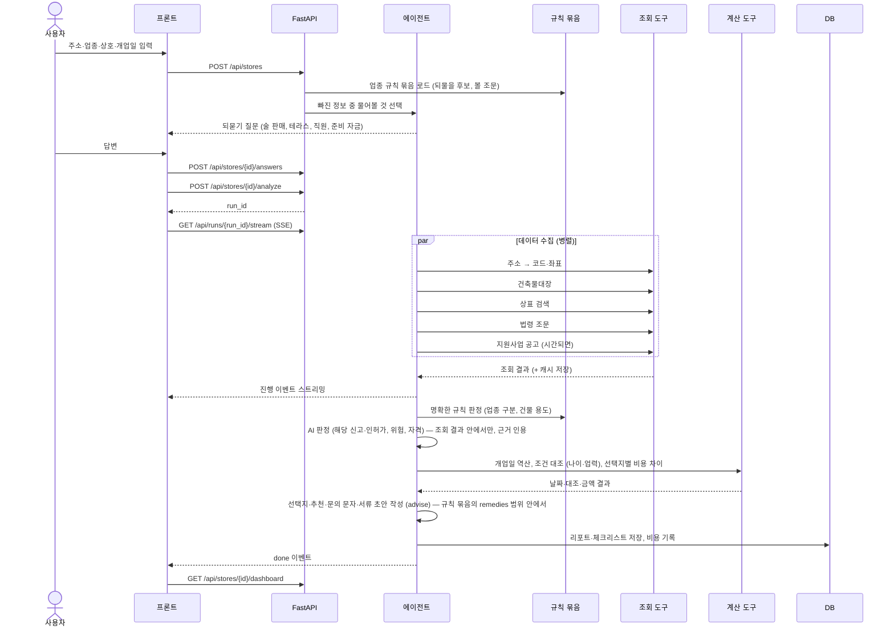
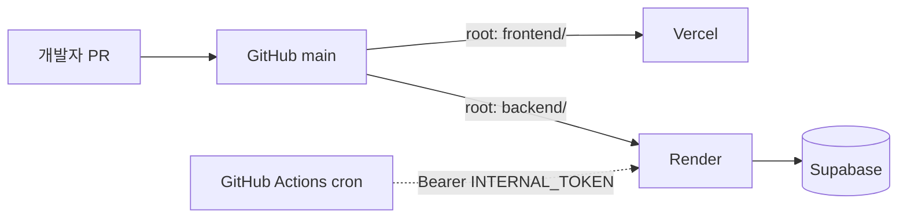

# 아키텍처, 인프라

# 청년 창업가 종합 솔루션 — 아키텍처 · 인프라

> 기준 문서: 기획서(청년 창업가를 위한 종합 솔루션), 예선 마감 2026-11-23(월) 17:00
시연 업종: 카페·음식점 / 팀 4명 / 모노레포(frontend, backend)
API 명세는 별도 문서 `API명세서.md` 참고
> 

### 변경 이력

| 날짜 | 내용 |
| --- | --- |
| 2026-11-17 | 최초 작성 |
| 2026-11-18 (3차) | 점검 리포트를 **"결과물 + 결정 한 번"** 구조(결론·안 하면 생기는 일·선택지·추천·대신 만든 결과물·사용자가 할 일 1개)로 변경. 선택지·초안 생성 단계(`advise`)와 `agent/advise.py`, 규칙 묶음의 `remedies`·`drafts`, 선택 적용 API(`/choose`), 데이터 모델 필드 추가 |
| 2026-11-18 (2차) | **지원사업 자격 판정 주체를 AI로 확정**(공고문 데이터 안에서 판정, 숫자 조건 대조만 계산 도구), 자격 값 `eligible / partial / unknown` 통일, API 명세서를 이 문서에 맞춰 전면 갱신 |
| 2026-11-18 | 판정 구조를 **AI 판정 + 계산 도구 + 규칙 묶음**으로 변경, 일정표·신고를 **개업 체크리스트**로 통합, **내 가게 챗봇**과 **입지·상권 지도·매물 비교** 추가, **대출 안내 제외**, 데이터 모델·폴더 구조·외부 API·환경변수 갱신 |

---

## 0. 구현 범위

| 표기 | 의미 |
| --- | --- |
| **[핵심]** | 예선 링크에서 실제 데이터로 동작해야 함 |
| **[시간되면]** | 핵심 완료 후 실제 데이터로 연결 |
| **[예시]** | 예시 데이터로 화면만 시연. 응답에 `is_example: true`, 화면에 "예시 데이터" 배지 |
| **[로드맵]** | 소개서·발표에만 등장, 구현하지 않음 |

| 기능 | 범위 |
| --- | --- |
| 가게 등록 + 되묻기 | [핵심] |
| 점검 리포트 (건물·법·상호) | [핵심] |
| 결과 카드: 선택지·추천·대신 만든 결과물(문의 문자·특약 문구·서류 초안), 선택 적용 | [핵심] (후보 자리로 바꾸는 선택지는 [시간되면]) |
| 개업 체크리스트 (시기별·카테고리별, 개업일 역산) | [핵심] |
| 내 가게 대시보드 + 알림 조회 | [핵심] |
| 예시로 해보기 (이서연 씨 사례) | [핵심] |
| 내 가게 챗봇 (근거 기반 답변, 조건 변경 시 재계산) | [시간되면] |
| 정책 알림 (지원사업 자격 판정) | [시간되면] |
| 입지·상권 지도 (후보 자리, 주변 동종 가게) | [시간되면] |
| 매물 비교 (입력값 합산·비교, 현장 질문 생성) | [시간되면] |
| 다시 조회 → 바뀐 것만 알림 (수동 버튼) | [시간되면] |
| 상권 분석의 메뉴·가격대, 지역 평균 임대료, 개업 6개월 후 알림 화면 | [예시] |
| 예약 자동 재조회, 상권 모니터링, 폐업 안내, 다른 업종 | [로드맵] |
| 대출 안내 | 제외 |

> 우선순위: 핵심 5개가 "예시로 해보기"로 끝까지 동작한 뒤에 [시간되면]에 착수한다.
> 

---

## 1. 전체 아키텍처



### 1-1. 처리 흐름: 데이터 수집 → AI 판정 → 알림



### 1-2. 판정 구조: AI 판정 + 계산 도구 + 규칙 묶음

기획서 방침대로 **판정은 AI가 한다**. 공고문 자격 조건이나 조문 적용은 글로 쓰여 있고 가게마다 사정이 달라서 미리 정한 규칙으로 다 담을 수 없기 때문이다. 다만 시연 중 틀리면 치명적인 두 가지는 보완한다.

- **답이 하나로 정해진 계산**(날짜, 금액 합산, 숫자 조건 대조)은 AI가 직접 하지 않고 **계산 도구**를 불러 결과를 받는다.
- **법에 명시된 명확한 구분**(주류 판매 → 일반음식점, 업종별 건물 용도)은 **규칙 묶음**이 판정하고, AI는 그 결과를 설명한다.

| 판단 | 주체 | 조건 |
| --- | --- | --- |
| 데이터 조회, 캐시 | 조회 도구 | 실패 시 캐시 → mock |
| 업종 구분 (주류 → 일반음식점) | 규칙 묶음 |  |
| 건물 용도 적합 여부 | 규칙 묶음 | 데이터에 표기가 없으면 "판단 불가" |
| 개업일 역산 날짜, 기한 계산 | 계산 도구 | 개업일 변경 시 즉시 재계산 |
| 매물 비용 합산, ㎡당 임대료, 버틸 수 있는 기간 | 계산 도구 |  |
| 나이·업력 같은 숫자 조건 대조 | 계산 도구 | 조건 값은 AI가 공고문에서 추출 |
| 되물을 질문 고르기 | AI | 규칙 묶음의 후보 중 선택 |
| 내 가게에 해당하는 신고·인허가 판정 | AI | 규칙 묶음이 지정한 조문 범위 안에서, 근거 조문 인용 |
| 위반 소지 판정 (광고 문구, 상호 유사성 등) | AI | 결과는 `low`(확인 권장) 이하 |
| 지원사업 자격 판정 (글로 된 조건) | AI | `eligible / partial / unknown`, 공고문 문장 인용 |
| 공고문·조문 요약, 입지 비교 요약, 현장 질문 생성 | AI | 숫자는 데이터·계산 결과 그대로 |
| 선택지 구성, 추천 이유, 쉬운 말 결론 | AI | 선택지 종류는 규칙 묶음의 `remedies` 안에서만. 기간·금액은 근거(규칙·계산·데이터)가 있을 때만 쓰고 없으면 "확인 필요" |
| 선택지의 금액·기간 차이 (후보 자리 변경 시 월 고정비 차이 등) | 계산 도구 | 후보 자리 입력값 기준 |
| 문의 문자·특약 문구·신고서류 초안 작성 | AI | 가게 정보와 조회 데이터를 문장에 채우는 것으로 제한, 모르는 칸은 `[확인 필요]`, 법률 효력 문서는 참고용 문구 부착 |
| 선택 적용 (`/choose`) | 코드 | 선택지의 `apply`를 가게 정보·기준 자리에 반영하고 필요하면 재분석 |
| 챗봇 답변, 조건 변경 해석 | AI | 이 가게의 근거 안에서만, 변경 전 사용자 확인 |

> 공통 원칙: AI는 **조회한 데이터 안에서만** 판정하고, 판정마다 근거(조문·공고문 문장·데이터 원값)를 붙인다. 근거가 없으면 `unknown`으로 두고 관할 기관 확인을 안내한다.
> 

---

## 2. 백엔드 내부 구조

```
backend/
├── main.py                    # FastAPI 앱, 라우터 등록, CORS
├── api/                       # 라우터 (API 명세서의 엔드포인트)
│   ├── stores.py              # 가게 등록·되묻기·수정, 대시보드
│   ├── runs.py                # 분석 실행 + SSE
│   ├── report.py              # 점검 리포트, 선택지 적용(/choose)
│   ├── checklist.py           # 개업 체크리스트
│   ├── chat.py                # 내 가게 챗봇
│   ├── map.py                 # 지도, 후보 자리, 매물 비교, 상권(예시)
│   ├── grants.py              # 정책 알림
│   ├── alerts.py              # 알림, 다시 조회
│   ├── demo.py                # 예시로 해보기, 헬스체크
│   └── internal.py            # 예약 재조회 (토큰 보호)
├── agent/
│   ├── loop.py                # 에이전트 루프 (tool use)
│   ├── prompts/               # 되묻기, 판정, 선택지·초안, 요약, 챗봇 프롬프트
│   ├── judge.py               # AI 판정 + 근거 검증 (근거 없으면 unknown)
│   ├── advise.py              # 결과 카드 생성: 선택지·추천·초안 (remedies 범위, 숫자는 계산 도구 결과)
│   ├── chat.py                # 챗봇 대화 → actions 생성
│   └── cost.py                # 토큰·비용 기록
├── rules/
│   ├── engine.py              # 규칙 묶음 로드, 업종 구분·건물 용도 판정
│   └── packs/
│       └── cafe_restaurant.yaml
├── calc/                      # 계산 도구 (AI가 tool로 호출)
│   ├── dates.py               # 개업일 역산, 기한 계산
│   ├── costs.py               # 매물 비용 합산, ㎡당 임대료, 버틸 수 있는 기간
│   └── match.py               # 나이·업력 등 숫자 조건 대조
├── tools/                     # 조회 도구 (각각 mock 대체 경로 포함)
│   ├── address.py
│   ├── building.py
│   ├── law.py
│   ├── trademark.py
│   ├── commercial.py          # 상가(상권)정보
│   ├── grants.py              # K-Startup / 기업마당
│   └── cache.py
├── mocks/                     # 도구별 모의 응답 + 예시 데이터(상권 메뉴·가격, 지역 평균 임대료)
├── db/
│   ├── models.py
│   └── migrations/
└── tests/scenarios/
```

### 2-1. AI 모듈과 백엔드의 인터페이스

AI 모듈(`agent/`)은 순수 파이썬 함수로 제공하고, 백엔드가 import해서 호출한다. 조회 도구와 계산 도구는 `agent/ports.py`의 Protocol(`Tools`, `Calc`, `ToolResult`)만 만족하면 되어서, 실제 구현이 없어도 가짜 객체로 양쪽이 독립 개발할 수 있다.

| 함수 | 입력 | 출력 | 쓰는 API |
| --- | --- | --- | --- |
| `select_questions(llm, pack, store)` | 가게 입력, 규칙 묶음 | 되물을 질문 (필수 질문은 항상 포함) | `POST /stores`, `/answers` |
| `run_analysis(store, tools=, calc=, llm=, emit=)` | 가게, 조회·계산 도구, SSE 이벤트 콜백 | `AnalysisResult` (리포트 항목, 체크리스트, 요약, 비용) | `POST /analyze`, SSE |
| `chat(llm, ctx, message, history, focus)` | 이 가게의 저장된 결과(`ChatContext`: 가게, 리포트 항목, 체크리스트), 대화 기록, 질문 대상 | `ChatReply` (답변, 근거, 제안 동작, 안내 문구) | `POST /chat` |

- 백엔드가 구현할 것: `tools.building(store)`, `tools.trademark(name)`, `tools.law(check_id)`, `calc.checklist_dates(opening_date, week)`, `calc.site_cost_delta(base, other)`. 반환 형태는 `agent/ports.py` 상단 주석에 있다. 조회 실패는 예외 대신 `ToolResult(ok=False)`로 돌려준다.
- `emit(event, data)`로 `step` / `item` / `done` 이벤트가 나온다. 백엔드가 `run_id`를 붙여 SSE로 내보내고, 결과 `AnalysisResult`를 DB에 저장한다.
- 예시로 해보기(`POST /api/demo`)의 저장 결과는 `backend/mocks/demo/seoyeon.json`이다. 되묻기 질문, 진행 이벤트(재생용), 리포트 항목, 체크리스트가 들어 있어서 백엔드는 이 파일을 복사해 새 `store_id`로 만들면 된다. 입력은 `seoyeon_inputs.json`이고, `scripts/build_demo.py`로 다시 만든다. 데모 시나리오 S1~S4는 `backend/tests/scenarios/`에 고정돼 있다.
- 챗봇은 근거를 AI가 쓰지 않는다. AI가 인용할 항목 id를 고르면 코드가 그 항목의 근거를 붙이고, 근거를 댈 수 없는 사실 답변은 "판단 불가"로 바꾼다. 조건 변경은 `actions`로 제안만 하고(`requires_confirm`), 값과 id는 코드가 검증한다. 대화 기록은 백엔드가 매번 넘기며 서버에 저장하지 않는다.
- 순서가 고정된 파이프라인이다: 조회 → 규칙 판정 → AI 판정 → 결과 카드 → 체크리스트. 도구가 실패해도 해당 항목을 `unknown`으로 두고 끝까지 진행한다.

---

## 3. 인프라

### 3-1. 구성

| 구성 요소 | 서비스 | 플랜 | 역할 |
| --- | --- | --- | --- |
| 프론트 | Vercel | 무료 | Next.js 배포, `main` 머지 시 자동 배포 |
| 백엔드 | Render Web Service | 무료 (시연 주간만 유료 검토) | FastAPI, 에이전트, SSE |
| DB | Supabase PostgreSQL | 무료 | 가게·결과·알림·캐시 저장 (Render 파일시스템은 재시작 시 사라지므로 외부 DB 필수) |
| 지도 | 카카오맵 또는 네이버 지도 JS SDK | 무료 한도 확인 필요 | 지도 화면 표시 (프론트에서 직접 로드) |
| 예약 실행 | GitHub Actions `schedule` | 무료 | 하루 1회 `/internal/refresh` 호출 (로드맵) |
| 비밀값 | Vercel / Render 환경변수 | — | 저장소에는 `.env.example`만 |
| 코드 리뷰 | CodeRabbit | — | `.coderabbit.yaml` |

### 3-2. 배포 구조



### 3-3. 인프라 리스크와 대응

| 리스크 | 영향 | 대응 |
| --- | --- | --- |
| Render 무료 서버 슬립 (15분 무요청 시) | 심사위원 첫 접속 시 약 1분 대기 | 시작 화면에서 `/api/health` 선호출 + "서버 준비 중" 안내, 심사 기간에는 유료 인스턴스 검토 |
| 국가법령정보 OC의 IP 등록 | 배포 서버에서 조문 조회 차단 가능 | 1일차에 Render에서 호출 테스트. 막히면 고정 아웃바운드 IP 확인 후 등록, 그래도 안 되면 시연 조문 사전 캐시 |
| 외부 API 장애·한도 초과 | 리포트 생성 실패 | 모든 도구에 mock 대체, `api_cache` 재사용, "예시로 해보기"는 저장된 결과로 동작 |
| AI 판정 오류 | 잘못된 위험 안내 | 명확한 구분은 규칙 묶음, 계산은 계산 도구, AI 판정은 근거 인용 필수·근거 없으면 `unknown`, 데모 시나리오로 회귀 확인 |
| 지도 SDK 도메인 등록·한도 | 지도 화면 안 뜸 | Vercel 배포 도메인을 SDK 콘솔에 등록, 실패 시 지도 없이 비교표만 표시 |
| SSE가 중간에 끊김 | 진행 화면 멈춤 | 결과는 DB에 저장되므로 `GET /api/runs/{id}`로 폴링 대체 |
| LLM 비용 증가 | 예산 초과 | 단계별 모델 분리, 같은 공고·조문 판정 결과 캐시, `cost_logs`로 실측 |

### 3-4. 환경변수

| 변수 | 위치 | 설명 |
| --- | --- | --- |
| `NEXT_PUBLIC_API_BASE_URL` | frontend | 백엔드 주소 |
| `NEXT_PUBLIC_MAP_JS_KEY` | frontend | 지도 SDK JavaScript 키 (도메인 제한으로 보호) |
| `DATABASE_URL` | backend | Supabase 연결 문자열 |
| `FRONTEND_ORIGIN` | backend | CORS 허용 출처 |
| `LLM_API_KEY`, `LLM_MODEL_FAST`, `LLM_MODEL_MAIN` | backend | 되묻기·요약용 / 판정·챗봇용 모델 |
| `JUSO_API_KEY`, `JUSO_COORD_API_KEY` | backend | 도로명주소 검색 / 좌표 |
| `DATA_GO_KR_KEY` | backend | 공공데이터포털 서비스키 (건축물대장, 상가정보, K-Startup) |
| `LAW_OC` | backend | 국가법령정보 OC |
| `KIPRIS_API_KEY` | backend | KIPRIS Plus |
| `BIZINFO_API_KEY` | backend | 기업마당 |
| `USE_MOCK` | backend | `true`면 모든 조회 도구가 모의 응답 사용 |
| `INTERNAL_TOKEN` | backend, GitHub Secrets | 예약 재조회 엔드포인트 보호 |

---

## 4. 데이터 모델 (PostgreSQL)

```mermaid
erDiagram
    stores ||--o{ runs : has
    stores ||--o{ report_items : has
    stores ||--o{ checklist_items : has
    stores ||--o{ sites : has
    stores ||--o{ grant_matches : has
    stores ||--o{ alerts : has
    runs ||--o{ cost_logs : has
    report_items |o--o{ checklist_items : adds

    stores {
        uuid id PK
        text name "상호"
        text business_type_input "사용자 입력 업종"
        text business_type "규칙 묶음이 결정한 신고 업종"
        text address
        text address_detail "층·호"
        jsonb address_codes "법정동코드, 번, 지, 좌표"
        date opening_date
        jsonb answers "술 판매, 테라스, 직원, 준비 자금"
        int owner_birth_year "정책 자격용, 선택"
        text region
        bool is_demo
        timestamptz created_at
        timestamptz updated_at
    }
    runs {
        uuid id PK
        uuid store_id FK
        text trigger "user | refresh | chat | demo"
        text status "queued | running | done | failed"
        jsonb events "진행 로그"
        timestamptz started_at
        timestamptz finished_at
    }
    report_items {
        uuid id PK
        uuid store_id FK
        uuid run_id FK
        text check_id "규칙 묶음의 항목 id"
        text stage "계약 전 | 개업 전 | 운영 중"
        text title
        text verdict "high | low | unknown | ok"
        text decided_by "rule | ai"
        text reason
        text consequence "안 하면 생기는 일"
        jsonb options "선택지: label, summary, time, cost, apply, site_id"
        jsonb recommendation "option_id, reason"
        jsonb prepared "대신 만든 결과물: 문의 문자, 특약 문구, 서류 초안, 링크"
        jsonb user_action "사용자가 할 일 1개: type, text, est_minutes"
        text chosen_option "사용자가 고른 option_id"
        timestamptz chosen_at
        jsonb evidence "출처, 원값, 조문, 링크, 조회 일자"
    }
    checklist_items {
        uuid id PK
        uuid store_id FK
        uuid report_item_id FK "source=report일 때"
        text task
        text category "영업 인허가 | 세무 | 고용 | 건물·시설 | 간판·광고 | 표시 의무 | 정책"
        text group_label "계약 전 | 개업 4주 전 | 개업 직전 | 개업 후"
        int dday
        date due_date "계산 도구가 계산"
        jsonb documents "필요 서류"
        jsonb prepared "신고서류 초안 등 대신 만든 결과물"
        text agency "담당 기관"
        text source "rule | report | grant"
        jsonb evidence
        bool done
    }
    sites {
        uuid id PK
        uuid store_id FK
        text label "A, B ..."
        text address
        jsonb coord
        bool is_main
        jsonb building_check
        jsonb area_metrics "동종 업소 수 등"
        jsonb listing "보증금, 월세, 관리비, 권리금, 면적"
        jsonb listing_result "비용 계산, 평균 대비, 현장 질문"
    }
    grant_matches {
        uuid id PK
        uuid store_id FK
        text grant_id "공고 id"
        text result "eligible | partial | unknown"
        jsonb checks "조건별 결과와 공고문 인용"
        jsonb summary
        timestamptz judged_at
    }
    alerts {
        uuid id PK
        uuid store_id FK
        text type "grant_new | grant_deadline | data_changed | checklist"
        text title
        text body
        jsonb diff "변경 전후"
        bool is_example
        bool read
        timestamptz created_at
    }
    api_cache {
        text key PK "source:params 해시"
        text source
        jsonb payload
        timestamptz fetched_at
        timestamptz expires_at
    }
    cost_logs {
        uuid id PK
        uuid run_id FK
        text step
        text model
        int input_tokens
        int output_tokens
        numeric cost_krw
    }
```



- 로그인은 없다. 가게는 `store_id`(UUID)로 식별하고, 프론트는 `localStorage`에 `store_id`를 기억한다. URL `/stores/{id}`로 다시 열 수 있다.
- 챗봇 대화 기록은 저장하지 않고 프론트가 `history`로 보낸다. 조건 변경은 `stores`와 `runs(trigger=chat)`에 남는다.
- 예시 데이터는 DB에 넣지 않고 `mocks/`에서 읽어 응답 시 `is_example: true`를 붙인다.

---

## 5. 외부 API 연동

| 도구 | 외부 API | 쓰는 정보 | 캐시 만료 | 상태 |
| --- | --- | --- | --- | --- |
| `address` | 행정안전부 도로명주소 검색 / 좌표 API | 법정동코드, 번·지, 좌표 | 30일 | 신청 즉시 사용 가능 |
| `building` | 국토부 건축HUB 건축물대장 (표제부, 층별개요) | 주용도, 층별 용도·면적, 사용승인일 | 7일 | **위반건축물 표기 제공 여부 확인 필요** |
| `law` | 국가법령정보 공동활용 (OC) | 조문 원문, 시행일, 링크 | 1일 | **배포 서버 IP 등록 확인 필요** |
| `trademark` | KIPRIS Plus 상표 | 유사 상표, 분류, 상태 | 7일 | 키 승인 시간 확인 필요 |
| `commercial` | 소상공인시장진흥공단 상가(상권)정보 | 반경 내 업소 목록·업종·좌표 | 7일 | **개폐업 추이·유동인구는 제공하지 않을 가능성 높음 → 확인 필요** |
| `grants` | K-Startup 사업공고, 기업마당 지원사업 | 공고 제목, 기간, 대상, 원문 링크 | 1일 | 응답 필드 확인 필요 |
| (프론트) | 카카오맵 또는 네이버 지도 JS SDK | 지도 표시, 마커 | — | **선택과 무료 한도 확인 필요** |
| (예시) | 한국부동산원 상업용부동산 임대동향 | 지역 평균 임대료 | — | 제공 단위(상권·분기)와 가져오는 방법 확인 전까지 [예시] |
| (예시) | 없음 | 주변 가게 메뉴·가격 | — | 공개 데이터 없음 → [예시] |

> 민간 상권 서비스(예: 오픈업)의 데이터는 약관상 재배포·상업적 재가공이 금지되어 있어 쓰지 않는다. 필요하면 화면에서 외부 링크로만 연결한다.
> 

### 도구 공통 인터페이스

```python
class ToolResult(BaseModel):
    ok: bool
    source: str            # "건축물대장 층별개요"
    data: dict | None
    fetched_at: datetime
    from_cache: bool
    from_mock: bool        # True면 SSE에 fallback 이벤트, 응답 evidence에 표시
    error: str | None
```

- 실패 순서: 실제 API → 캐시(만료돼도 사용) → mock. 어느 단계든 `from_cache`/`from_mock`을 기록한다.
- 타임아웃: 외부 API 5초, LLM 30초.

---

## 6. 규칙 묶음 (업종 확장의 단위)

에이전트·조회 도구·계산 도구는 업종과 무관하게 공통이다. 업종마다 달라지는 것은 규칙 묶음 하나다.

`rules/packs/cafe_restaurant.yaml` 구조 (요약)

```yaml
pack: cafe_restaurant
ask: [sells_alcohol, uses_terrace, has_employees, funds_krw]   # 되물을 후보
derive:                                                        # 규칙으로 정하는 값
  business_type: "sells_alcohol ? 일반음식점 : 휴게음식점"
checks:                                                        # 점검 리포트 항목, 볼 조문, 가능한 대응
  - id: building_use
    remedies: [change_business_type, change_site, request_use_change]   # 선택지로 만들 수 있는 대응 유형
    drafts: [inquiry_message, contract_clause]                          # 대신 만들 초안 유형
  - id: building_violation
    remedies: []
    drafts: [inquiry_message]
  - id: alcohol_vs_type
    remedies: [change_business_type]
    drafts: []
  - id: trademark_similar
    remedies: [rename_store, proceed]
    drafts: []
  - id: ad_claims
    remedies: [rewrite_copy]
    drafts: []
checklist:                                                     # 개업 체크리스트 기본 항목
  - { task: 건물 확인·임대차 계약, category: 건물·시설, week: -8 }
  - { task: 위생교육 신청, category: 영업 인허가, week: -6 }
  - { task: 건강진단, category: 영업 인허가, week: -5 }
  - { task: 영업신고, category: 영업 인허가, week: -4 }
  - { task: 사업자등록, category: 세무, week: -3 }
  - { task: 간판 신고·카드 단말기, category: 간판·광고, week: -2 }
  - { task: 근로계약서·4대보험, category: 고용, week: -1, when: has_employees }
```

- `remedies`는 항목별로 선택지로 만들 수 있는 대응 유형이고 `drafts`는 대신 만들 초안 유형이다. AI는 이 범위 안에서만 선택지와 초안을 만들어 법적 근거 없는 대응을 지어내지 않는다. `change_site`는 후보 자리가 있을 때만 선택지로 나온다.
- 규칙 묶음은 "무엇을 볼지"를 정하고, 각 항목이 이 가게에 해당하는지와 위험한지는 AI가 조회 결과를 근거로 판정한다. 날짜는 계산 도구가 `week` 값으로 계산한다.
- `required: true`인 질문(예: 주류 판매 여부)은 AI가 되묻기에서 빼도 항상 묻는다. `titles`는 점검 항목의 판정별 제목 템플릿, `checklist_task`는 그 항목이 걸렸을 때 연결되는 체크리스트 기본 항목이다.
- 실제 순서·기간과 조문 번호는 D 담당이 사전조사로 확정한 뒤 반영한다.
- 새 업종 = 이 파일 하나 추가. 에이전트·도구·API 코드는 바뀌지 않는다.

---

## 7. 역할별 담당 (4명)

| 역할 | 담당 범위 |
| --- | --- |
| A. 에이전트·LLM | `agent/`, 되묻기·판정·선택지·초안·요약·챗봇 프롬프트, 근거 검증, `/chat`, 비용 기록 |
| B. 데이터 도구·DB | `tools/`, `calc/`, `mocks/`, `api_cache`, Supabase 스키마, 외부 API 확인 |
| C. 프론트·배포 | 화면(시작, 등록, 조사 중, 내 가게, 리포트, 체크리스트, 지도, 정책, 챗봇 패널), SSE, 지도 SDK, Vercel·Render 배포 |
| D. 규칙·문서 | `rules/`, 데모 시나리오 테스트, 예시 데이터 작성, 소개서·AI 활용내역·영상 |

API 계약(`API명세서.md`)을 확정하면 C는 mock JSON으로, A·B는 엔드포인트별로 병렬 개발할 수 있다.

---

## 8. 개발 전 확인 목록

- [ ]  건축물대장 응답에 위반건축물 표기가 있는가 → 없으면 `building_violation`은 항상 `unknown` + 열람 안내
- [ ]  법령 API가 Render 서버에서 호출되는가 (IP 등록)
- [ ]  상가(상권)정보 API의 반경 조회 응답 항목 → 개폐업·유동인구가 없으면 지도는 동종 업소 수 중심
- [ ]  K-Startup·기업마당 공고 API의 대상·지역·연령 필드 유무 → 없으면 AI가 공고문에서 조건을 뽑고 `unknown` 허용
- [ ]  지도 SDK 선택(카카오맵 / 네이버 지도), 무료 한도, 배포 도메인 등록
- [ ]  지역 평균 임대료 원천(한국부동산원 임대동향 등)의 제공 단위와 가져오는 방법
- [ ]  Render 무료 인스턴스 콜드 스타트 시간 측정
- [x]  API 명세서를 이 문서 기준으로 갱신 (2026-11-18 완료)
- [ ]  `docs/report-schema.json`을 API 명세서 형식으로 갱신, `CLAUDE.md`의 판정 원칙("규칙으로 판단할 수 있는 것은 코드")과 폴더 구조(`api/`, `calc/`, `db/`, `rules/packs/`)를 이 문서에 맞게 수정