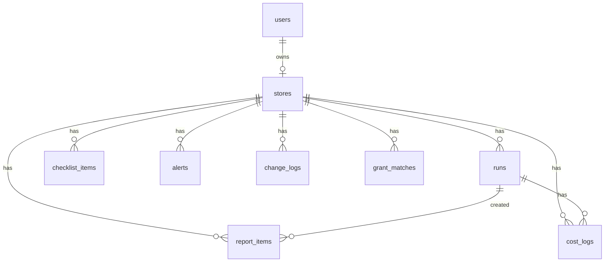

# Foundy DB 스키마 (PostgreSQL)

> 기준: `dev` 브랜치 `backend/db/migrations/versions/0001_init.py` — Railway PostgreSQL에 실제로 적용된 구조 (2026-11-20).
> 컬럼 설명·처리 흐름은 `docs/DB 명세서.md`가 기준이다. 이 파일은 빠르게 보기 위한 요약본이다.

## 1. 한눈에 보기



| 테이블 | 역할 | 사용 시점 |
| --- | --- | --- |
| `users` | 계정 (지금은 `provider='demo'`만 사용) | 사용 중 |
| `stores` | 가게 정보, 계정당 1개 | 사용 중 |
| `runs` | 분석 실행 1회와 진행 이벤트 | 사용 중 |
| `report_items` | 점검 카드 내용 + 사용자 진행 상태 (선택·실행·메모) | 사용 중 |
| `checklist_items` | 개업 체크리스트 (기본 `c-*`, 선택지로 생긴 `x-*`, 지원사업 `g-*`) | 사용 중 |
| `alerts` | 알림 (`decision`·`next`·`deadline`·`change`·`grant`) | 사용 중 |
| `change_logs` | 마이페이지 변경 기록 | 마이페이지 수정 구현 때 |
| `grant_matches` | 지원사업 자격 판정 결과 | 시간되면 |
| `api_cache` | 외부 API 응답 캐시 | 분석 API 구현 때 |
| `cost_logs` | LLM 토큰·비용 기록 | 분석·챗봇 구현 때 |

## 2. 공통 규칙

- id는 `uuid` (`gen_random_uuid()`, `pgcrypto`). 화면·API는 가게 안에서만 유일한 `item_key`(`r-01`, `c-04`, `x-1`)를 쓴다. API의 `item_id` = `item_key`.
- 정해진 값은 Postgres enum 대신 `text` + `CHECK`.
- 시각은 `timestamptz`(UTC 저장, 응답은 +09:00), 날짜는 `date`.
- 가게를 지우면 하위 데이터가 모두 `ON DELETE CASCADE`로 지워진다. 계정을 지우면 가게도 지워진다.
- `updated_at`은 애플리케이션이 갱신한다 (트리거 없음).
- 규칙(점검 항목, 체크리스트 기본 항목, 서류, 연락처, 카드↔체크리스트 연결)은 DB가 아니라 `backend/rules/packs/cafe_restaurant.yaml`에 있다.

## 3. 명세서와 다른 점

| 테이블 | 변경 | 이유 |
| --- | --- | --- |
| `cost_logs` | `run_id` NULL 허용, `store_id` 컬럼 추가 | 챗봇 호출은 `runs`를 만들지 않는다 (`runs_one_active` 충돌 방지). 명세서 2-10의 두 번째 방식 |

## 4. DDL (실제 적용본)

```sql
CREATE EXTENSION IF NOT EXISTS pgcrypto;

CREATE TABLE users (
  id               uuid PRIMARY KEY DEFAULT gen_random_uuid(),
  provider         text NOT NULL CHECK (provider IN ('kakao','google','naver','demo')),
  provider_user_id text,                        -- 소셜 쪽 사용자 id. demo는 NULL
  name             text NOT NULL,               -- 마이페이지에서 바꿀 수 있는 표시 이름
  joined_at        date NOT NULL DEFAULT CURRENT_DATE,
  created_at       timestamptz NOT NULL DEFAULT now(),
  updated_at       timestamptz NOT NULL DEFAULT now()
);
CREATE UNIQUE INDEX users_provider_uid ON users (provider, provider_user_id)
  WHERE provider_user_id IS NOT NULL;

CREATE TABLE stores (
  id                  uuid PRIMARY KEY DEFAULT gen_random_uuid(),
  user_id             uuid NOT NULL UNIQUE REFERENCES users(id) ON DELETE CASCADE,  -- 계정당 1개
  name                text NOT NULL,                  -- 상호 (원본. 선택으로 바뀐 이름은 report_items.applied_effects)
  business_type_input text NOT NULL DEFAULT '카페'
                       CHECK (business_type_input IN ('카페','음식점')),
  business_type       text,                           -- 규칙 묶음이 결정한 신고 업종 (휴게음식점|일반음식점)
  address             text NOT NULL,                  -- 도로명주소 (입지를 정한 주소)
  address_detail      text NOT NULL DEFAULT '',       -- 층·호
  address_codes       jsonb,                          -- {sigungu_cd, bjdong_cd, bun, ji, coord:{lat,lng}}
  region              text,                           -- 주소에서 얻은 시군구·동 (예: 서울 성동구 성수동)
  opening_date        date NOT NULL,                  -- 개업 예정일 (역산 기준)
  owner_birth_year    int CHECK (owner_birth_year BETWEEN 1900 AND 2100),  -- 지원사업 자격용, 선택
  sells_alcohol       boolean NOT NULL DEFAULT false,
  uses_terrace        boolean NOT NULL DEFAULT false,
  has_employees       boolean NOT NULL DEFAULT false,
  funds_krw           bigint CHECK (funds_krw >= 0),  -- 준비 자금, 선택
  onboarded_at        timestamptz,                    -- 첫 설정(분석)을 마친 시각. NULL이면 첫 설정 중
  is_demo             boolean NOT NULL DEFAULT false,
  created_at          timestamptz NOT NULL DEFAULT now(),
  updated_at          timestamptz NOT NULL DEFAULT now()
);

CREATE TABLE runs (
  id          uuid PRIMARY KEY DEFAULT gen_random_uuid(),
  store_id    uuid NOT NULL REFERENCES stores(id) ON DELETE CASCADE,
  trigger     text NOT NULL CHECK (trigger IN ('user','refresh','chat','demo')),
  scope       jsonb NOT NULL DEFAULT '[]',   -- 다시 돌린 단계: ["building","law","trademark","checklist","grants"]
  status      text NOT NULL DEFAULT 'queued' CHECK (status IN ('queued','running','done','failed')),
  events      jsonb NOT NULL DEFAULT '[]',   -- [{step,status,message,source,at}]
  error       text,
  started_at  timestamptz,
  finished_at timestamptz,
  created_at  timestamptz NOT NULL DEFAULT now()
);
CREATE INDEX runs_store ON runs (store_id, created_at DESC);
-- 같은 가게에서 동시에 하나만 실행 (409 RUN_IN_PROGRESS)
CREATE UNIQUE INDEX runs_one_active ON runs (store_id) WHERE status IN ('queued','running');

CREATE TABLE report_items (
  id              uuid PRIMARY KEY DEFAULT gen_random_uuid(),
  store_id        uuid NOT NULL REFERENCES stores(id) ON DELETE CASCADE,
  run_id          uuid REFERENCES runs(id) ON DELETE SET NULL,   -- 이 내용을 만든 실행
  item_key        text NOT NULL,           -- 'r-01' … (API의 item_id)
  check_id        text NOT NULL,           -- 규칙 묶음의 점검 항목 id (building_use …)
  stage           text NOT NULL CHECK (stage IN ('계약 전','개업 전','운영 중')),
  -- 내용 (분석이 만든다)
  verdict         text NOT NULL CHECK (verdict IN ('high','low','unknown','ok')),
  decided_by      text NOT NULL CHECK (decided_by IN ('rule','ai')),
  title           text NOT NULL,           -- 결론 한 줄 (쉬운 말)
  reason          text,
  consequence     text,                    -- 안 하면 생기는 일
  options         jsonb NOT NULL DEFAULT '[]',   -- 선택지 (아래)
  recommendation  jsonb,                   -- {option_id, reason} 또는 NULL
  user_action     jsonb,                   -- {type, text, est_minutes} 또는 NULL (기본 할 일)
  contact_key     text,                    -- 규칙 묶음 contacts의 키 (build|hyg|…). 번호는 응답 때 채운다
  evidence        jsonb NOT NULL DEFAULT '[]',   -- Evidence 목록 (비면 verdict는 unknown)
  -- 사용자 진행 상태
  chosen_option   text,                    -- 고른 option_id. 아직이면 NULL
  chosen_at       timestamptz,
  action_status   text NOT NULL DEFAULT 'pending' CHECK (action_status IN ('pending','sent','done')),
  action_reply    text,                    -- 결과·통화 메모
  action_updated_at timestamptz,
  verdict_before  text CHECK (verdict_before IN ('high','low','unknown','ok')),
  resolved_title  text,                    -- 선택 적용 후 바뀐 결론
  applied_effects jsonb NOT NULL DEFAULT '{}',   -- 유효 값에 덧씌울 효과 (아래)
  applied_changes jsonb NOT NULL DEFAULT '[]',   -- 화면에 보일 바뀐 내용 문장 목록
  created_at      timestamptz NOT NULL DEFAULT now(),
  updated_at      timestamptz NOT NULL DEFAULT now(),
  UNIQUE (store_id, item_key),
  UNIQUE (store_id, check_id)
);
CREATE INDEX report_items_store_stage ON report_items (store_id, stage);

CREATE TABLE checklist_items (
  id              uuid PRIMARY KEY DEFAULT gen_random_uuid(),
  store_id        uuid NOT NULL REFERENCES stores(id) ON DELETE CASCADE,
  item_key        text NOT NULL,        -- 'c-01'…'c-09' (기본), 'x-0'… (선택지로 생김), 'g-…' (지원사업)
  source          text NOT NULL CHECK (source IN ('rule','report','grant')),
  rule_key        text,                 -- 규칙 묶음의 항목 키 (서류 목록을 찾는 키)
  task            text NOT NULL,
  category        text NOT NULL CHECK (category IN ('영업 인허가','세무','고용','건물·시설','간판·광고','표시 의무','정책')),
  group_label     text NOT NULL CHECK (group_label IN ('계약 전','개업 4주 전','개업 직전','개업 후')),
  offset_days     int NOT NULL,         -- 개업일 기준 일수 (음수 = 개업 전). 규칙 묶음 값
  due_date        date NOT NULL,        -- opening_date + offset_days (계산 도구)
  agency          text,                 -- 담당 기관 이름
  contact_key     text,                 -- contacts 키 (번호는 응답 때 채운다)
  origin_item_key text,                 -- source='report': 이 항목을 만든 점검 카드 item_key
  origin_option   text,                 -- source='report': 이 항목을 만든 option_id
  evidence        jsonb NOT NULL DEFAULT '[]',
  done            boolean NOT NULL DEFAULT false,
  done_at         timestamptz,
  auto_checked    boolean NOT NULL DEFAULT false,  -- 점검 카드 완료로 자동 체크됐는지
  created_at      timestamptz NOT NULL DEFAULT now(),
  updated_at      timestamptz NOT NULL DEFAULT now(),
  UNIQUE (store_id, item_key)
);
CREATE INDEX checklist_store_due ON checklist_items (store_id, due_date);

CREATE TABLE alerts (
  id          uuid PRIMARY KEY DEFAULT gen_random_uuid(),
  store_id    uuid NOT NULL REFERENCES stores(id) ON DELETE CASCADE,
  dedupe_key  text NOT NULL,          -- 같은 사건을 중복 생성하지 않는 키 (아래 표)
  type        text NOT NULL CHECK (type IN ('decision','next','deadline','change','grant')),
  title       text NOT NULL,
  body        text,
  cta         jsonb,                  -- {label, page, item_id}
  diff        jsonb,                  -- 변경 전후 (선택)
  is_example  boolean NOT NULL DEFAULT false,
  read        boolean NOT NULL DEFAULT false,
  created_at  timestamptz NOT NULL DEFAULT now(),
  UNIQUE (store_id, dedupe_key)
);
CREATE INDEX alerts_store_type ON alerts (store_id, type, created_at DESC);

CREATE TABLE change_logs (
  id          uuid PRIMARY KEY DEFAULT gen_random_uuid(),
  store_id    uuid NOT NULL REFERENCES stores(id) ON DELETE CASCADE,
  changed     jsonb NOT NULL,                 -- [{field, from, to}]
  impacts     jsonb NOT NULL DEFAULT '[]',    -- ["building","law","checklist"]
  reset_items jsonb NOT NULL DEFAULT '[]',    -- [{item_key, title, chosen_label}] 초기화된 카드
  lines       jsonb NOT NULL DEFAULT '[]',    -- 화면 문장 ["주소: … → …", "건물 용도·주류 카드 선택 초기화 (다시 결정 대기)"]
  created_at  timestamptz NOT NULL DEFAULT now()
);
CREATE INDEX change_logs_store ON change_logs (store_id, created_at DESC);

CREATE TABLE grant_matches (
  id            uuid PRIMARY KEY DEFAULT gen_random_uuid(),
  store_id      uuid NOT NULL REFERENCES stores(id) ON DELETE CASCADE,
  grant_id      text NOT NULL,            -- 공고 id (예: kstartup-000000)
  title         text NOT NULL,
  source        text NOT NULL,            -- K-Startup | 기업마당 …
  url           text,
  category      text,                     -- 사업화 | 융자 | 공간 | 교육 | 멘토링
  region        text,
  amount_text   text,
  deadline      date,                     -- NULL = 상시·미정
  result        text NOT NULL CHECK (result IN ('eligible','partial','unknown')),
  checks        jsonb NOT NULL DEFAULT '[]',   -- [{condition, result: pass|unknown, evidence:{type:'notice', text, url}, note}]
  summary       jsonb,                    -- {who, how_much, until, what_to_submit[], by:'ai'}
  poster        jsonb,                    -- {url, source:'api'|'generated', credit}
  excluded      boolean NOT NULL DEFAULT false,   -- 명확히 fail → 목록 제외 (건수만 알림)
  added_to_checklist boolean NOT NULL DEFAULT false,
  judged_at     timestamptz NOT NULL DEFAULT now(),
  UNIQUE (store_id, grant_id)
);
CREATE INDEX grant_matches_store_deadline ON grant_matches (store_id, deadline);

CREATE TABLE api_cache (
  key         text PRIMARY KEY,         -- '<source>:<params 해시>'
  source      text NOT NULL,            -- address | building | law | trademark | grants
  payload     jsonb NOT NULL,
  fetched_at  timestamptz NOT NULL DEFAULT now(),
  expires_at  timestamptz NOT NULL
);
CREATE INDEX api_cache_expires ON api_cache (expires_at);

CREATE TABLE cost_logs (
  id             uuid PRIMARY KEY DEFAULT gen_random_uuid(),
  run_id         uuid REFERENCES runs(id) ON DELETE CASCADE,          -- NULL 허용 (챗봇 호출은 runs 없음)
  store_id       uuid REFERENCES stores(id) ON DELETE CASCADE,        -- 0001_init에서 ALTER로 추가
  step           text NOT NULL,         -- select_questions | interpret | advise | grants | chat …
  model          text NOT NULL,
  input_tokens   int NOT NULL DEFAULT 0,
  output_tokens  int NOT NULL DEFAULT 0,
  cost_krw       numeric(12,2) NOT NULL DEFAULT 0
);
CREATE INDEX cost_logs_run ON cost_logs (run_id);
```

## 5. 구조를 바꿀 때

- Railway 화면에서 테이블을 직접 만들거나 고치지 않는다.
- `backend/db/migrations/versions/`에 Alembic 리비전을 추가하고 `docs/DB 명세서.md`와 `backend/db/models.py`를 같은 PR에서 고친다.
- 배포할 때 `alembic upgrade head`가 자동으로 실행된다.
